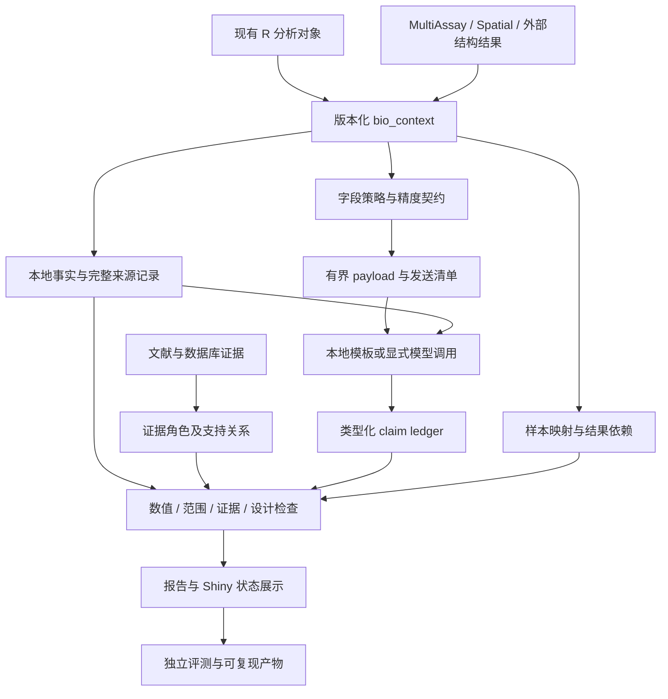

# BioExplainR 后续增强实施框架

版本：规划 v1.0；日期：2026-10-05；软件起点：0.3.1。

本文是依据 `BioExplainR-iMeta-Q1-submission-roadmap.docx` 和当前源码整理的实施设计。文中的新增 API、字段、目录和验收要求均为拟实施方案，不代表功能或研究已经完成。

## 1. 接手入口与目标

后续模型按以下顺序阅读：

1. [当前交接](../SESSION_HANDOFF.md)：已有结果、环境限制和交付版本。
2. 本文：架构、数据契约、兼容策略和阶段边界。
3. [实施任务卡](ENHANCEMENT_TASKS.md)：W00–W13 的依赖、修改范围、验收和交接提示词。
4. [研究与补充材料方案](ENHANCEMENT_RESEARCH_PLAN.md)：数据、独立评价、指标、人工材料和论文对应关系。
5. [原始投稿路线图](BioExplainR-iMeta-Q1-submission-roadmap.docx)：研究动机及完整建议。

中心目标：使 BioExplainR 的每条解释能关联到确定性事实、适用范围、证据角色和检查结果，并通过独立研究评价它是否减少统计错误、无支持生物学陈述及证据错配。

完成标准分两层：软件层证明契约和实现正确；研究层量化方法效果。研究未开始、结果不显著或未达到预期指标，都必须如实记录，不能由软件测试通过替代。

## 2. 现有能力与增量范围

以下是 W00 基线时对源码的静态核对；W01–W13 的当前实现和验收记录见 `docs/implementation_records/`，不能把本节原始静态核对当作后续功能状态。

| 已有基础 | 已核对的入口 | 增强重点 |
|---|---|---|
| `bio_context`、适配器注册和调度 | `R/context.R` | schema 版本、事实描述、范围、样本映射；新增空间与多组学对象 |
| JSON 与脱敏 | `R/utils.R`、`R/contracts.R`、`R/llm.R` | 开发版使用 17 位策略、payload policy、分离 hash 和 manifest；真实请求边界仍需 W09 运行记录 |
| 有界模型输入 | `bio_context_payload()`、`bio_payload_policy()` | 开发版支持显式 complete/chunked 策略；旧位置参数保留兼容 |
| 显式声明核对 | `R/explanation-validation.R`、`R/claims.R` | typed ledger、路径 token、scope/coverage findings；保留旧入口 |
| 本地与模型解释 | `R/explain.R`、`R/i18n-en.R` | 完整覆盖声明的登记与展示；保留原始文本和修订记录 |
| 证据构造、检索和缓存 | `R/evidence.R`、`R/evidence-live.R` | 分开来源类型、证据角色、支持关系及人工/模型判定来源 |
| 项目 DAG 和来源一致性 | `R/project.R` | sample map、跨模态冲突、派生与独立证据区分 |
| 图形核对、修复验证 | `R/plot-cross-check.R`、`R/validate.R` | 扩展自然案例评价；执行成功与不变量通过分开 |
| 报告与工作台 | `R/report.R`、`R/shiny-app.R` | ledger、检查范围、发送预览、冲突报告和中英文同步 |
| 规模实验与投稿审计 | `research/` | 保留旧结果；新建独立科学终点评价和明确版本入口 |
| CI | `.github/workflows/R-CMD-check.yaml` | 已有单一 Ubuntu 检查，补充版本、可选依赖和复现矩阵 |

当前基线是 5 个公开数据集、120 案例/480 facts 的机制实验、531 项源码检查记录。路线图里的 525 项检查是旧记录。已有功能、英文默认语言、ExpressionSet、多面板图和规模实验不作为重新开发任务。

## 3. 总体架构

实现仍沿用现有 S3/list 风格。大型原始数据、完整坐标、图像和样本标识留在本地源对象或显式本地文件中；context 保留紧凑摘要和可追踪引用。模型输出、检索文本和外部文件均作为输入数据处理，不能决定验证状态或自动触发代码执行。

## 4. 实施阶段与交付门槛

| 阶段 | 工作包 | 可交付结果 | 进入下一阶段的依据 |
|---|---|---|---|
| G0 基线与设计 | W00–W01 | 可用环境、基线记录、冻结的接口契约 | 当前源码测试状态真实记录；schema 和兼容策略明确 |
| G1 核心可靠性 | W02–W04 | 精度/发送策略/manifest、ledger、证据关系 | 端到端离线与模拟请求测试；旧入口可读写 |
| G2 应用扩展 | W05–W08、W10 开发案例 | 多组学、空间、按选定案例接入结构层、报告 | 真实开发对象端到端结果及人工可查看产物 |
| G3 独立研究 | W09、W11–W12、W10 独立案例 | 冻结评测、专家标注、逐任务效果与区间 | 开发/测试隔离、真实评价来源、完整失败记录 |
| G4 发布与论文 | W13 | 发布候选、复现说明、稿件和图表 | 清洁环境复现、作者材料、主张与结果一致 |

原路线图的 12–14 周是资源估算；这里以交付门槛推进。0.3.1 保留为基线，新开发版本号由 W01/W13 统一管理，不能把改变后的实现继续冒充旧实验版本。

空间支持是完整路线的重要模块。结构层在选定 docking 主案例后实施完整评价；正式用户任务研究在主张用户收益时执行。真实匹配多组学必须有可对齐的生物学模态；空间图像、PCA/UMAP、GO 注释或 docking 本身不自动构成第二个实测组学模态。

## 5. 跨模块数据契约

W01 将本节落实为 `docs/DATA_CONTRACTS.md` 和版本化 schema/fixture。字段名以冻结后的契约为准，后续变更须附迁移说明和受影响任务，不由各模型分别发明。

### 5.1 Context 与事实描述

保留现有 `analysis_type/source_class/source_package/source_status/facts/top_features/plot_mapping/provenance/uncertainty/metadata/adapter/language`。

| 拟新增内容 | 含义与约束 |
|---|---|
| `schema_version` | context 契约版本；缺失时按 legacy 读取，不自动填出未知来源 |
| `context_id` | 对规范化语义内容求哈希的标识；排除创建时间和自身 hash |
| `scope` | `dataset_id/analysis_id/species/tissue/modality/assay/comparison_id/region_id/section_id` 等已知范围；未知值保留 unknown/null |
| `design` | 独立重复单位、配对关系、group/batch/donor/timepoint；与事实来源绑定 |
| `fact_descriptors` | 按 fact 路径描述 `value_type/unit/source_path/computation/inspection/completeness`；区分全量计算、抽样摘要、显示值 |
| `provenance` 扩展 | 源包版本、参数、输入摘要 hash、外部文件 hash、参考 ID、变换链 |

原有 `facts` 路径和类型尽量保持；新结构不得覆盖旧的统计量或隐式更换阈值。完整 facts 指适配器正式定义的全部摘要事实，不意味着完整原始矩阵全部进入 context。

本地 sample map 等较大映射放在项目级 sidecar 或显式本地资源中；context 保存摘要、键和 hash。报告、模型发送清单分别决定可公开字段，不能直接序列化本地资源。

### 5.2 精度、序列化与 manifest

1. 数值传输以 R double 的可往返表示为目标。路线图建议的“17 位”必须结合 `jsonlite` 实际 `digits` 语义验证，不可只改常量就宣布无损。展示舍入仍由 `.fmt_num()` 处理。
2. 为整数、有限浮点数、极小 p、零、逻辑、字符、NA/NaN/Inf 和空数组定义编码。NA 不能变成零；超出安全整数范围的标识使用字符；非有限值须携带缺失/不可比较原因。
3. 规范化对象键顺序，保留数组、表格行和有语义的向量顺序；记录 UTF-8、序列化版本及数值策略。不要为获得相同 hash 任意排序观测。
4. 区分 `facts_hash`（完整已定义事实）、`payload_hash`（实际发送的脱敏内容）、`request_hash`（去掉鉴权信息的最终请求体）、`response_hash`（指定保存表示）。不对含秘密的原始配置直接求公开 hash。
5. 规范化语义 hash、实际发送字节 hash 和脱敏归档 hash 分别命名；记录 hash 所覆盖的内容及转换过程，避免对“原始响应”与“脱敏响应”混称。
6. `.json()`、解释 prompt、项目 prompt、HTTP body、研究脚本和评分程序使用同一数值策略；测试在 mock HTTP 边界捕获实际请求。

拟定 manifest 包含：`manifest_version/run_id/context_id/facts_hash/payload_hash/request_hash/response_hash/schema_version/serialization_version/numeric_policy/policy_id/code_hash/package_version/model_requested/model_reported/provider_host/created/usage/elapsed_sec/attempt/status`。

文件产物用相对路径、大小和 SHA-256；创建时间不进入语义 hash。manifest 不对包含自身的 ZIP 求自引用 hash；ZIP hash 放在外部交付清单中。文件或注释缺失时明确标为 missing，不能生成占位“成功”记录。

### 5.3 有界 payload 与字段策略

- 分开 local context、model payload、public report 三个字段策略；用户自定义 metadata、notes、feature/cluster/term 标签也必须进入策略。
- 默认 allowlist 配合递归值检查；普通基因符号等科学标签可按声明策略保留，样本、患者、barcode 和本地路径采用本地映射或去除。伪名化不等于匿名化保证。
- `max_top` 必须是有限非负整数；`max_chars` 与实际发送 UTF-8 字节计数分别记录；输入预算规则写入协议。
- 优先削减 top-feature 预览；正式默认路径不得静默截断 facts。仍超限时明确返回带原因的错误，或走用户显式选择的分块策略。
- 分块/删减模式记录 `included_fact_paths/omitted_fact_paths/truncation_reason/completeness`，检查器只能核查可见且范围匹配的内容，不能把遗漏部分记为通过。
- 加入 `bio_explain()`、`bio_explain_project()`、诊断、报告和模型低层接口的泄漏回归，覆盖自定义 ID、嵌套字段、URL、错误消息及证据文本。低层接口的保护范围在文档中单独说明。

### 5.4 Typed claim ledger

ledger 一行/项对应一个原子声明；一段同时谈数字与机制的文本须拆分或保留“仍有未覆盖文本”。提取器覆盖率是单独评价终点，不能由模型只提交正确 claims 来获取整段 pass。

| 字段 | 约定 |
|---|---|
| `id` | 在一次 explanation 内唯一且稳定 |
| `schema_version` | 声明结构的版本；同一契约下的各条声明使用相同版本 |
| `claim_type` | `statistical_fact/statistical_interpretation/biological_association/causal/evidence_support/design/plot_mapping/unknown` |
| `text`、`origin` | 原文与来源 `local_template/model/user`；修订保留原文和 parent ID |
| `text_ref` | 所在 section、索引或原文片段；未映射 prose 仍标为 unverified |
| `context_id`、`fact_path` | 单一对象的事实引用；跨结果声明通过关系引用多个明确 context |
| `value`、`value_type`、`unit` | 标量和值类型；数值字符串仅按明确类型解析，不能把基因 ID 转为数字 |
| `direction` | 适用于带符号效应或已声明方向的统计量；计数不是效应方向 |
| `scope` | 与 context 对齐的比较方向、模态、物种、组织、区域和样本层级 |
| `evidence_refs` | 证据 ID 和声明希望使用的角色；模型请求的角色不是验证结论 |
| `validation` | 验证器计算的状态、逐项 findings、检查范围、规则版本；不接受模型自报 pass |

路径方案须兼容旧的 `fact/reference/path` 与 `facts.x`、`x.1`、`top_features.1.x`。对于名称自身含点号等歧义，建议内部使用路径 token 数组，旧字符串只在兼容层解析；禁止 `eval(parse())` 路径访问。

`top_features` 是有限预览，部分值可能已舍入。引用预览值时 findings 必须标记 `reference_scope = preview`；不能升级为完整源结果核对。

### 5.5 验证状态与检查范围

| 状态 | 含义 |
|---|---|
| `pass` | 在已声明 scope 内所有必需检查均已执行并满足；不是全文/科学真理证明 |
| `fail` | schema、引用、数值、范围或必需支持关系存在可确定的违反 |
| `partial` | 有检查通过，但仍有必需部分未验证或不可评估 |
| `unverified` | 没有足够可核查信息，或仅有模型/未审阅提取结果 |
| `not_assessable` | 当前能力或证据类型明确无法评价，须带原因 |

聚合规则：确定性失败优先；有通过但剩余必需项未知时为 partial；全部必需项通过才为 pass；没有实际通过时不能靠引用 ID 存在获得 pass。另保留 `facts_status/evidence_status/scope_status/prose_status` 和覆盖率，避免单一状态掩盖遗漏。

旧图形 `not_checkable`、修复 `runtime_only/invariants_passed` 等不全局改名；通过显式报告映射对齐展示。旧 `bio_validate_explanation()` 保留返回 explanation 的契约，`validation$status/findings/n_claims` 可继续读取。更严格判定造成的状态变化需写明迁移原因，不强行维持旧的误通过。

因果声明不会凭表达、共定位、数据库定义或 docking 自动 pass。专家判断作为独立的 reviewed annotation 显示；自动状态和人工判断分列。

### 5.6 Evidence 与支持关系

保留 `bio_evidence` 现有 ID 和构造签名，新增字段通过兼容的命名参数扩展。

| 内容 | 约定 |
|---|---|
| 来源 | `source/source_id/url/version/accessed/content_hash`，保留引用定位 |
| 内容类型 | `title/abstract/full_text_excerpt/database_definition/annotation/method`，内容不可得则记录缺失 |
| 范围 | 物种、组织、实验条件、测量模态和结论强度 |
| 支持关系 | claim–evidence pair 上的 `supports/contradicts/definition_only/irrelevant/unknown` |
| 角色 | `definition/annotation/method/dataset_support/experimental_support/structural_computation` |
| 判定来源 | `rule/model_proposed/user_declared/expert_reviewed`；审阅时间、匿名评者 ID、rubric 版本、定位片段 |

支持关系是边的属性，不是文献整体的永久“支持”标签。同一文献可以支持 A、反对 B；相同 DOI 的不同检索命中不得算独立支持。专家标注的测试 gold 必须与运行时可见的证据内容隔离。

规则只能确定字段一致性、角色限制和可判定的错配。单纯增加 `supports` 枚举不能声称实现了文献语义理解；自动语义判断只能生成候选，接受独立专家评价。

### 5.7 多组学项目与 sample map

- `MultiAssayExperiment` 的 `assay/primary/colname` 映射作为起点，增加 modality、biological unit、timepoint、replicate role 等明确字段；技术重复可以多对一，重复键冲突和真实重复不得混为一谈。
- 模态内列名、colData 和映射按 ID 对齐；禁止按当前行序猜测。缺失样本、未匹配列、样本交集和排除规则必须可查询。
- 保留每模态 context；联合 context 的 `modalities` 列出 assay、模态、单位和子 context ID，项目持有子 context 与本地映射。项目新增 sample alignment 摘要和跨结果 findings，原有依赖 DAG 继续表达上游到派生结果。
- `derived_from` 保持无环；`supports/contradicts/overlaps` 是另一类关系，不套用同一 DAG 约束。
- agreement/discordance 只在 feature ID、物种、比较方向、样本范围和可比尺度明确时计算；未知映射和反向比较须显式处理。
- feature 映射保存版本、映射基数、一对多处理和丢失比例；不能把不同单位的效应或不同模态 p 值直接合并。

### 5.8 空间对象与结果

- `SpatialExperiment` 是 SCE/SE 派生类，新适配器应在 `.builtin_adapters()` 中先于通用 SCE/SE 检测；Seurat spatial 必须依靠实际空间对象/图像元数据或显式选择，不能只看 assay 名称。
- 读取 `spatialCoords/imgData/colData/assayNames` 及 section/sample/donor/region；使用上游公开 accessor，记录实测版本。
- 事实包含切片/样本/spot 数、坐标单位与范围、坐标缺失、QC、区域计数及已有空间统计；组织覆盖率需有合法 mask/分母，不能从坐标范围猜测。
- 邻域优先读取已有图；显式计算 kNN/radius 时记录单位、距离、k/r、边界、种子及是否跨切片。默认不跨切片连边，不密集化超大矩阵。
- 空间结果携带方法、邻接定义、效应、原始/校正 p 和多重检验；单切片和 spot 数不能代替患者重复数。
- cross-check 检查 ID、区域子集、坐标变换与比例尺、图层和源表关系；不支持的图层返回 not_checkable，不能仅凭无错误返回 pass。

### 5.9 结构计算结果

第一阶段解析一个有真实文件和版本说明的引擎格式及通用规范表；随后用独立 parser 扩展，不能把一张人为统一表作为“多引擎实测”。

至少记录 receptor/ligand 及物种、结构来源和 hash、引擎/版本、预处理、搜索空间、seed、score 名称/方向/单位、pose/cluster/RMSD、对照和参数敏感性。RMSD 标明相对晶体构象还是搜索结果；接触残基仅在真实提供或明确计算时填写。

不完整结果可读入，但相应科学声明只能 partial/unverified。不同引擎 score 不能直接合并排名。外部引擎执行放在可复现研究环境，包内默认只解析和审计。

## 6. 拟新增 API 与集成策略

以下签名是契约讨论基线，尚不能作为已可运行的用户教程。W01 确定最终参数与返回值；优先复用现有入口，避免为每个检查增加一个公开函数。

| API 方向 | 输入与返回 | 接入点 |
|---|---|---|
| `bio_context_manifest(ctx, ...)` | context → 版本化 manifest | payload、报告、实验 runner |
| `bio_payload_policy(...)` | 明确字段策略 → policy 对象 | 作为 `bio_context_payload()` 的追加命名参数 |
| `bio_claim_ledger(explanation, ...)` | explanation/claims → 标准 ledger | 本地与模型解释、报告 |
| `bio_claim_policy(...)` | 必需检查和容差 → policy | 明确规则版本与比较类型 |
| `bio_validate_claims(explanation, ...)` | explanation → 附 ledger/findings 的 explanation | 旧 validator 委托兼容层 |
| `bio_evidence_support(claim, evidence, ...)` | 已有 pair 与候选/人工标注 → relation | 不自动生成专家确认标签 |
| `bio_context(mae/spatial, ...)` | 新对象 → context | 自动/显式 adapter；可增加薄封装 |
| `bio_project(..., sample_map = ..., relations = ...)` | 多 context → 项目及对齐/冲突 findings | 保留原有 parameters 和 dependencies |
| `bio_docking_context(result, ...)` | 结果文件/表和 provenance → context | 结构层 parser；新增模块 |

`bio_spatial_neighbors()`、`bio_spatial_cross_check()` 仅在现有扩展点无法清晰承载时导出。所有新参数用命名调用，保留现有位置参数；旧构造对象缺新字段时正常读取并报告信息不足。

新增依赖策略：空间、多组学和引擎相关包优先 Suggests + `requireNamespace()`，基础离线功能不依赖大型上游包。哈希等核心依赖若确需加入 Imports，记录理由。使用公开 accessor；NAMESPACE/man 由 roxygen 生成。

保持 `bio_explain(use_llm = NA)` 的已有配置行为；测试和示例显式 `use_llm = FALSE`。项目解释、证据检索和代码执行仍按现有显式开关；修订模型文本如需追加调用，要有最大轮数、成本记录和原文保留。

## 7. 报告、可用性与跨模块完成标准

用户主流程为“导入已有分析对象 → 查看 facts 和设计 → 添加证据 → 查看解释与声明状态 → 检查冲突 → 导出”。Shiny 展示科学上有用的信息；底层 hash 和完整 manifest 放下载/详情，不占据主流程。

报告需要包含：事实来源、claim 表、各检查维度、证据关系、未核查文字、样本/模态缺失、冲突和不能推出的结论。保持 English 默认、中文可选；机器字段和状态码不随语言变化。

每个工作包的完成证据包括：

- 代码及文档契约一致；正常、边界和失败路径都有与风险相称的测试。
- 跳过的可选依赖明确列出；未安装不能写为支持已验证。
- 调用旧 API、读取旧对象和旧结果的兼容证据。
- 一个最小离线示例；真实数据测试另列来源、版本和记录。
- 实际命令、退出状态、依赖版本、产物路径和未解决事项。
- 涉及新增统计解释时，模板、模型 prompt、验证器和报告同时更新，避免相互矛盾。

软件测试不因研究指标低而改写金标准。路线图的 top-1、false-pass、recall 等阈值是预设研究目标；未达到则报告失败并用新的独立评测轮次验证改进。

## 8. 路线图要求与执行框架对应

| 路线图内容 | 实施位置 | 需要补足的证据 |
|---|---|---|
| §3 历史状态混杂 | W00、W13 | 当前 manifest 与明确 historical 入口 |
| §4.1 typed claims | W01、W03、W08 | 独立声明及未覆盖 prose 评价 |
| §4.2 多模态 | W05、W10 | 真实匹配数据、sample map、冲突结果 |
| §4.3 空间/结构 | W06–W07、W10 | 真实空间对象、空间负对照、结构 decoy |
| §4.4 精度/manifest | W02、W09 | 请求边界精度和重建一致性 |
| §4.5 隐私/执行 | W02、W12 | 实际发送检查及研究端隔离记录 |
| §5 独立评价 | W09、W11–W12 | 开发隔离、专家标准、逐任务指标与区间 |
| §6 主案例 | W10 | 科学问题、可比模态、失败/冲突解释 |
| §7–8 人类与统计 | W11；研究方案 | 真实标注、伦理资料、预设分析 |
| §9–14 稿件/发布 | W13 | 公开复现、作者材料、论文证据索引 |

路线图内部的“80/100”和“P0 清零”是团队准备度规则，期刊 scope、分区和送审要求仍需届时核验。上述框架用于组织可审查的工作，不预设录用概率或实验正结果。
