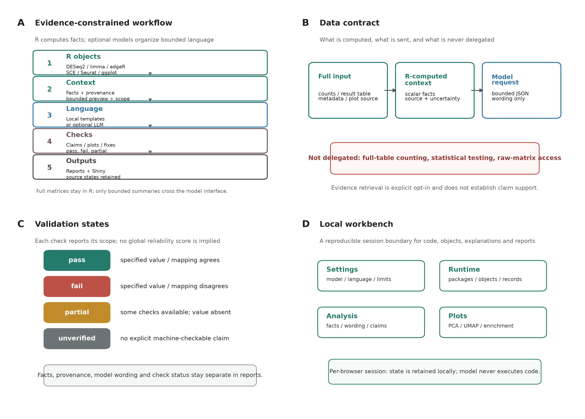
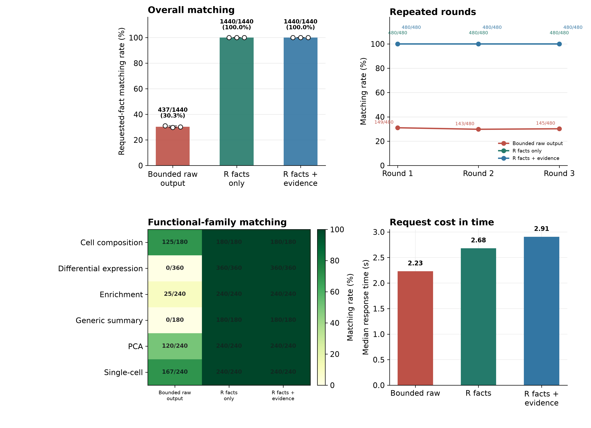
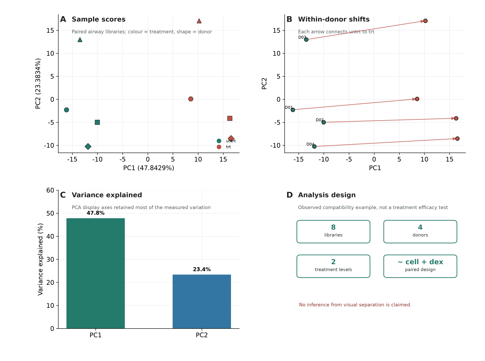
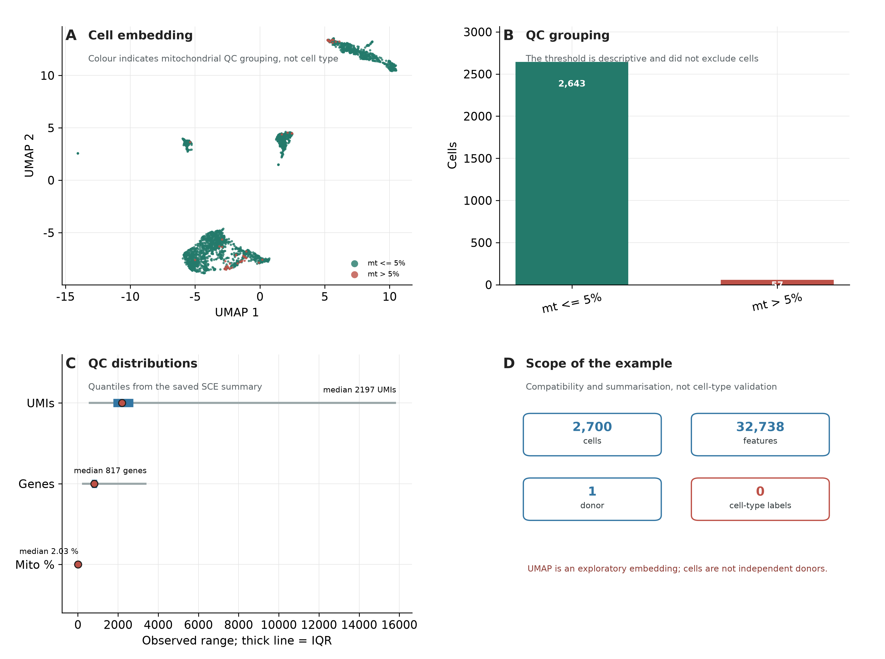
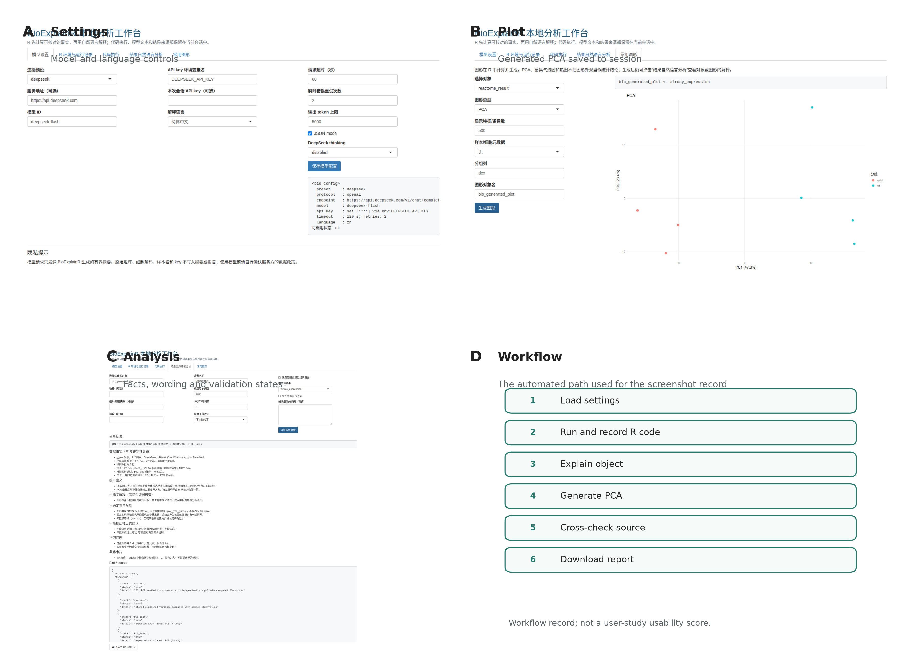

# 摘要

**动机：** 初级生物信息学研究者能够运行分析代码，却可能难以判断结果中的比较方向、统计阈值和生物学含义。我们开发 BioExplainR，将统计计算保留在 R 侧，再由本地模板或可选模型组织具有来源状态的解释。

**方法：** 我们将输入对象的事实提取、模型语言组织、声明/图形核对和修复不变量分别实现；在五个公开数据集（airway、PBMC3k、pasilla、ALL 和 bladderbatch）上进行分层对象接入与事实核对，并以 120 个可复现案例、480 个目标事实、三种输入方法和三轮重复调用评价事实传递，再以外部评分者聚合评价和浏览器自动化记录软件行为。外部评价数据仅作描述性功能感知分析。

**结果：** airway 在 P_adj < 0.05 且 |log2FC| > 1 时得到 999 个显著特征，其中上调 519 个、下调 480 个。主实验共完成 1,080 次 DeepSeek 请求和 4,320 条逐事实评分；有界原始输出严格匹配 437/1,440（30.35%），覆盖率为 35.83%，已回答准确率为 84.69%，R 事实摘要和 R 事实加证据均为 1,440/1,440（100%）。StepFun 与 DeepSeek 的双模型规模任务各为 480/480；独立 pasilla 数据的 30 项事实核对全部通过。3 位外部评分者对 30 个匿名解释案例的 720 条评分总体均值为 1.751/2，case-dimension 完全一致率为 93.75%；30 位评分参与者对 5 项功能的 150 条功能感知评分总体均值为 91.98/100，144/150（96.0%）标记为有用。

**结论与可用性：** 在本研究的固定输入和受控挑战中，BioExplainR 保留了确定性事实、来源和检查状态；这些结果不证明模型自由文本、生物学解释或真实用户收益。外部评分是未预注册、无对照任务的描述性功能感知评价，不是随机对照、SUS、学习增益或临床效用证据。软件采用 MIT 许可证，验证环境为 R 4.3.3、BioExplainR 0.3.1；公开代码仓库、发布 DOI 和通讯作者信息待作者补齐。

**关键词：** 生物信息学；R；大语言模型；确定性事实；可追溯解释；声明验证；Shiny

# 1 引言

RNA-seq 与单细胞分析依赖多个 R/Bioconductor 软件包：DESeq2、limma 和 edgeR 实施统计推断，Bioconductor、SingleCellExperiment 和 Seurat 组织实验对象，ggplot2 表达图形映射 [1-7]。这些计算结果仍需解释。本文将初级生物信息学研究者（primary bioinformatics researchers）定义为能够运行 R 代码、但尚不能独立判断统计与生物学含义的用户。其常见困难包括把文库数或细胞数当作独立重复、混淆原始与校正 P 值、反转比较方向，以及从富集显著性直接推断通路激活。

面向生物信息学的大语言模型工具已覆盖细胞类型标注、工作流辅助、基因集解释和通用代理。GPTCelltype、SCassist、GeneAgent 和 AnnDictionary 分别研究这些任务及其评价 [8-11]；BioChatter、Biomni 和 BioMaster 连接知识资源、任务规划与代码执行 [12-14]。iSEE 提供实验对象交互探索，ellmer 提供 R 中的模型调用基础设施，llm2geneset 结合模型生成基因集与过度表示分析 [15-17]。CASSIA、scExtract 等工作进一步扩展了单细胞标注与分析 [18,19]。这些方向与“解释已有 R 对象并留下可检查记录”相关，但评价对象不同，不能把任务自动化、标注准确率和统计事实传递混作一个指标。

已有对象的解释入口还面临一个具体信息问题：完整矩阵或结果表不宜直接送入模型，而仅提供顶部行又不足以确定全表计数；即使完整提供一个子表，逐行精确计算也属于可由 R 直接完成的工作。一般性生成文本的流畅度不能保证事实正确 [20]。因此，需要明确区分上游统计计算、摘要生成、语言组织和验证状态，而不是用一个总体“可信度”代替它们。

我们提出 BioExplainR，将统计计算保留在 R 侧，把可选模型限定为基于有界摘要组织语言，并提供显式声明验证、图形交叉核对与修复不变量检查。贡献是三个相互连接的工作流设计：带来源状态的统一对象摘要；事实、引用、图形及修复的分项检查记录；连接代码执行、解释与报告的本地工作台。我们以 120 个可复现案例、480 个目标事实评价三种输入条件，并以两个 OpenAI-compatible 模型运行相同规模的共同任务；另加入外部评分者案例评分和功能感知评分，报告协议边界、受控挑战结果、语义负例与未覆盖边界。工具的设计比较见表 1；相近工具仍不作共同任务性能排名。

# 2 方法

## 2.1 研究设计与评价终点

本研究是软件方法学研究，包含四个相互区分的评价层级：系统功能与对象接入验证、固定案例的结构化事实传递消融、未参与 airway/PBMC3k 开发的 pasilla 数值事实核对，以及外部评分者的描述性功能感知评价。另以浏览器自动化检查工作流连通性和页面状态。软件测试、受控机制挑战、独立数据核对和外部评分不共享同一性能终点，也不互相替代。

预先定义的主要软件终点是：适配器从 R 源对象提取的事实与独立 R 计算值一致；模型响应中的目标 fact-path 和标量值按固定容差匹配；声明、图形映射和修复不变量返回预设状态。辅助终点包括结构化响应覆盖率、已回答准确率、响应时间、协议解析状态和功能感知评分。所有模型实验使用固定案例、提示和保存的参考事实；结果按重复调用报告描述性统计，不进行超出实验设计的泛化推断。

## 2.2 系统架构

BioExplainR 0.3.1 接收已有 R 分析对象、用户提供的实验背景以及可选源结果。专用适配器将输入转化为 `bio_context`，记录分析类型、来源类与包、来源状态、确定性事实、有界顶部行、图形映射、参数和不确定性；有界 JSON 载荷分别供本地解释或可选模型使用。解释、检查结果和来源共同进入 HTML、Markdown/Quarto 报告与 Shiny 工作台（图 1）。

支持的接口包括 DESeq2 `DESeqResults`、limma `MArrayLM`、edgeR 检验对象与 `TopTags`、ORA/GSEA 风格对象、clusterProfiler 风格富集对象 [21]、Seurat、SingleCellExperiment、SummarizedExperiment、`prcomp`、ggplot 与矩阵。多系数 limma 拟合必须指定系数；普通表格的列名只提示可能来源，不能确认生成软件。完整输入在 R 侧用于适用的统计事实计算，原始矩阵不随模型载荷发送。大矩阵的部分诊断采用有界取样或稀疏存储摘要，并标记检查范围，不能将其表述为全矩阵审查。实际测试版本与接口支持范围分别记录，避免把“可适配”写成“所有版本均已验证”。

## 2.3 确定性事实与分层解释

差异表达适配器从完整提供的结果计算特征数、校正 P 值缺失数、筛选数量和方向。对于校正阈值 α 与效应阈值 τ，显著集合为同时满足非缺失 P_adj、P_adj < α 和 |log2FC| > τ 的特征，上调与下调由集合内效应值的正负确定。P_adj 表示输入的校正 P 值；其计算方法沿用来源，或在用户明确指定时另行计算。缺少校正值时记录 raw-only 状态，不以原始 P 值冒充校正值。BH 校正遵循既有方法 [22]；DESeq2 的独立过滤可能产生缺失校正值，不能据此断言没有原始检验或没有变化 [1,23]。

输出解释包含数据事实、统计含义、生物学候选解释、不确定性和不能推出的结论。本地模板可离线运行；模型接收已经计算的事实，不承担全表重算。PCA 方差比例保留计算精度，显示文本可另行舍入；顶部预览采用有限有效数字。该模块保证摘要计算规则可检查，不保证上游设计、用户背景或模型自由文本正确。

## 2.4 证据与声明验证

用户显式开启检索后，系统可访问 Europe PMC、QuickGO、Reactome、KEGG 与 UniProt [24-28]，将来源 ID、标题、URL、访问时间和提供方式保存为证据对象。输出提供来源追踪入口；检索命中、数据库注释和论断支持是不同概念，系统目前不自动全文审读或评价证据支持强度。

模型按统一要求返回分节 JSON 及 `claims` 数组。验证器接收解释、上下文和给定证据集合，核对事实路径是否存在、值是否为可比较标量、数值或方向是否一致，以及引用 ID 是否属于该集合。非零参考值使用 10^-6 的相对容差，参考为零时使用 10^-6 的绝对容差；字符串精确匹配。顶部表路径核对的是保存的有界预览值。结果为 `pass`、`fail`、`partial` 或 `unverified`；没有显式声明的文字不记为通过。引用闭集检查不证明文章支持论断，声明通过也不验证未声明的措辞、因果解释或整段文本。

## 2.5 图形核对、执行记录与修复不变量

图形核对接收 ggplot 与独立提供的源对象，输出所检查映射的一致性状态。火山图按 ID 或可配对行检查效应方向与 P 值来源；BioExplainR PCA 图核对坐标、解释方差和轴标签，提供元数据时可核对分组；富集气泡图按条目 ID 检查标签、比例、Count、颜色与大小。允许预期子集需显式指定；复杂多点图层或不能配对的情况返回 `not_checkable`。核对针对标度和坐标变换前的映射值，不覆盖全部像素、裁剪、人工注释或视觉误导。

执行记录保存运行状态、警告、错误现场调用栈、对象摘要及包调用表达式。用户显式提交的修复代码在独立 R 进程运行，依据事先声明的类型、行数、因子水平等不变量检查输出；未设置不变量时，运行成功仅标为 `runtime_only`。不变量检查能拒绝违反指定条件的修复，不能证明所有语义保持；独立进程隔离会话状态，但不是操作系统安全沙箱。

## 2.6 Shiny 工作台

工作台基于 Shiny [29]，接收模型配置、用户 R 代码及工作区对象，提供运行环境、代码记录、对象解释、PCA/UMAP/富集/热图和报告下载。生成图形保存回会话工作区，可由用户选择源对象核对。每个浏览器连接拥有独立工作区副本、页面配置和运行记录。该设计可检查工作流连通性与浏览器连接间的页面状态隔离，不构成共享 R 进程文件、网络或包权限的多租户隔离。截图与自动化验证见补充图 S1 和补充材料 S7。

默认解释语言和 Shiny 界面为 English；用户可通过 `language = "zh"` 或界面选择切换为简体中文。primary bioinformatics researchers 可按需使用中文术语入口；语言选择只改变用户可见措辞，不改变 R 计算事实、检查状态或评分规则。这是界面设计选择，不是语言能力或跨语言性能声明。

## 2.7 数据集、预处理与统计流程

**airway。** 使用 airway 1.22.0 的 GSE52778 计数对象，来源为人气道平滑肌地塞米松研究 [30]。以细胞系作为配对项，使用 `~ cell + dex` 设计、`untrt` 作为参考水平，比较 `trt` 与 `untrt`。差异表达结果使用 DESeq2 1.42.0 的 `results()`；预设筛选阈值为 P_adj < 0.05，另以未经 LFC shrinkage 的 |log2FC| > 1 作为效应大小筛选条件。该效应条件不是以效应超过 1 为原假设的检验。用于 PCA 的样本和供体结构沿用 airway 对象的配对设计。

PCA 使用 `vst(blind = FALSE)`，从非恒定特征中选择方差最高的 500 个特征，中心化但不标准化。另用 limma 3.58.1 的 voom/经验贝叶斯流程和 edgeR 4.0.16 的准似然流程，在相同过滤和设计条件下生成兼容性对照 [2,3,31]。Reactome ORA 从保存的 Ensembl 映射快照中保留人类且出现在结果中的基因；以有注释基因为背景，对满足预设背景大小范围的通路进行超几何检验，并对全部检验进行 BH 校正。该分析用于验证对象接入和事实提取，不作为 clusterProfiler 上游流程的性能测试。

**PBMC3k。** 使用 10x Genomics 公开过滤矩阵 [32]，从对象元数据计算每细胞 UMI 数、检测基因数和线粒体比例，并分别构建 SingleCellExperiment 1.24.0 与 SeuratObject 5.0.1 对象。可视化表达按每细胞 10,000 缩放后取 log1p，选取最高方差的 1,000 个特征作 20 维 PCA，再由 uwot 0.1.16 生成 UMAP [33]；随机种子为 20261004，单线程运行，保留公开过滤矩阵中的全部细胞。该流程不实施完整细胞类型注释，不把细胞作为独立生物学重复，也不进行供体间推断 [34]。数据地址、SHA-256 和软件版本见补充材料 S1。

**ALL 与 bladderbatch。** 从固定的 Bioconductor 数据包归档读取 Biobase `ExpressionSet` 对象 [37,38]。ALL 仅检查表达矩阵维度、表型列和 BT 分组摘要；bladderbatch 另外检查癌症分组和批次字段。两者不在本研究中重新拟合差异表达模型、不进行批次校正，也不将分组摘要解释为生物学效应；完整任务边界和归档哈希见补充材料 S1。

## 2.8 消融设计、评分与重复结构

本轮规模主实验使用 120 个可复现案例和 480 个唯一目标事实，三种输入方法各重复三轮，共 1,080 次请求和 4,320 条逐事实评分。默认 BioExplainR 工作流在 R 中分析完整对象，向模型传递完整确定性事实和最多 10 行 top-feature 预览；`direct_bounded` 仅作为信息受限基线，不代表默认模型输入。

主实验固定 DeepSeek OpenAI-compatible 服务，请求模型 `deepseek-flash`，关闭 thinking，temperature = 0，启用 JSON mode，输出上限 5,000 tokens，timeout 120 s，瞬时错误最多重试一次 [35]。模型别名没有不可变快照编号，因此该参数设置不保证跨时间完全确定。规模实验包含 120 个可复现案例和 480 个唯一目标事实：差异表达 30 案例、富集 20 案例、PCA 20 案例、SingleCellExperiment 20 案例、细胞组成 15 案例和 generic 表格摘要 15 案例；每案例四个标量目标。案例由 R 程序生成，目标事实由 BioExplainR adapter 从完整输入计算；它们用于验证对象接入、摘要传递和协议行为，不代表 120 个独立生物学样本。

比较三种输入：bounded raw output（`direct_bounded`）只提供维度、有限行或对象结构，不提供完整目标事实；R-computed fact summary（`facts_only`）提供从完整输入计算的事实、来源和最多 10 行 top-feature 预览；R facts plus evidence（`facts_evidence`）额外提供保存的 Europe PMC 记录。三者使用相同输出要求和请求设置，每案例每方法调用三次，共 1,080 次请求；480 个目标每方法重复三轮，形成每方法 1,440 条、总计 4,320 条逐事实评分。原始基线允许无法判断时返回 null；这不是对代码执行代理的测试。完整逐项数据见表 8。

参考值由 R 从每个完整源对象独立计算，不使用模型响应。目标事实匹配率定义为匹配数/目标数，覆盖率为非 null 标量数/目标数，已回答准确率为匹配数/已回答数；未回答记为未完成，不作缺失值填补。每种输入方法对相同 120 个案例调用三次，共 1,080 次请求、4,320 条逐事实评分；重复共享输入和目标，因此只报告描述性匹配率、轮次均值和样本标准差，不将重复评分视为独立数据集或实施独立二项推断。

机制挑战在 18 个事实加证据响应的上下文中分别注入错误数字、未知路径、向量值、未知引用及仅路径无值声明，共 90 项；移除验证器时记录为 `unchecked`。图形挑战预设三张正确图和六种注入错误；修复挑战预设两段可运行代码，分别保持或反转参考水平。挑战指标只针对预设违例，不估计自然错误率或一般修复成功率。主实验提示、配置、评分规则和原始响应均在补充材料 S3-S4 中归档；主实验在一次开发迭代后完成，因此预先承认开发集乐观偏倚。研究报告参照 TRIPOD-LLM 的透明报告原则，但本研究不是临床预测研究 [36]。

## 2.9 双模型与代码代理共同任务

为进行协议适配对照，使用与规模主实验相同的 120 个案例、480 个目标事实和评分规则。StepFun `step-5-preview`、DeepSeek `deepseek-flash` 各运行一次。模型请求使用 OpenAI-compatible 协议、temperature = 0、最多 800 个输出 token；最终运行对两种模型均关闭 `response_format = json_object`，其中 StepFun 的关闭设置用于避免此前探针中的网关格式不稳定。所有响应均要求返回包含 `fact` 和标量 `value` 的 claims 数组；提示提供完整精度的数值，并要求非整数小数逐字符复制。结果按相同 fact-path、数值容差和覆盖率规则评分，保存逐案例脱敏响应与逐事实评分。该设计只评价结构化事实传递和协议适配，不评价自由文本、生物学推理、长期稳定性或模型排名。

两种模型接收完全相同的输入、prompt、token 预算和评分规则；每个模型均对同一批 120 个案例逐案例调用一次，最大输出为 800 tokens。**Both models received identical inputs, prompts, token budgets, and scoring rules; each model was called once per case.** 因此两者共享同一批 120 个案例、480 个目标事实、提示文本、数值容差、fact-path 规则、回答覆盖率定义和评分程序。旧的 6 案例/25 事实记录仅作为历史开发基线，不作为本研究当前共同任务结果。

## 2.10 相近工具入口与独立数据基准

为进行设计层面的入口核对，在独立临时 R 库中安装 iSEE 2.14.0、GPTCelltype 1.0.1 和 ellmer 0.5.0；另将 btw 列为候选工具，但不把未完成的安装尝试作为性能比较。iSEE 测试预先指定真实 PBMC3k SCE、已有 UMAP 和 `mito_qc` 变量，并由 Playwright 检查 DOM 属性和图像加载。GPTCelltype 测试从真实 PBMC3k counts 派生 3 个 cluster 和 30 行 marker 表，检查提示构建；不提供在线 API key。ellmer 与 BioExplainR 通过本地 OpenAI-compatible replay 服务重放 6 个保存 prompt，比较客户端响应文本。上述设计评价入口兼容性和传输解析，不评价细胞类型准确率、模型质量或工具优劣。

为提供未参与 airway/PBMC3k 开发的数值基准，使用 pasilla 1.30.0 数据归档，按 DESeq2 1.42.0 的 `~ type + condition` 设计比较 treated 与 untreated。预设 P_adj 阈值 0.01、0.05、0.10 和 |log2FC| 阈值 0、1，逐项比较 BioExplainR 从真实 DESeqResults 提取的特征数、显著数、上下调数和缺失校正值与直接源表计算值，共 6 个阈值组合、30 个事实。数据归档 SHA-256、计算脚本和逐项评分见补充表 S2-S3。

## 2.11 外部评分者评价设计

外部评分材料由 30 个去来源化解释案例组成，3 位评分者分别对每个案例的 8 个维度使用允许 0–2 分的量表：数字准确性、统计概念、生物学支持、可追溯性、不确定性、可读性、错误定位和语义保持。评分者只看到匿名解释和统一任务说明，不看到原始数据集、模型、方法或作者身份；本项目只保留聚合结果，不保留原始评分文件和个人评语。完全一致率定义为每个案例-维度中 3 位评分者分值相同的比例；相差不超过 1 分作为另一个描述性指标，不计算 ICC 或 kappa。

另设 30 个评分参与者的功能感知表，每人对 5 项功能给出 0–100 分，并选择“有用/没用”。该表没有任务正确率、完成时间、对照组、SUS、学习增益或信任校准终点，因此预先限定为描述性功能感知评价，而不是用户实验或教学效果研究。伦理、招募、同意和补偿信息在现有记录中不完整，结果只能在作者核实后用于投稿。

# 3 结果

## 3.1 软件与浏览器验证

在 R 4.3.3、Ubuntu 24.04 用户态环境中，testthat 的 525 项检查有 524 项通过、1 项因真实 DESeq2 类可用而跳过，失败与错误均为零；`R CMD check --no-manual --no-vignettes --no-build-vignettes` 为 `Status: OK`。浏览器自动化覆盖代码执行、DESeq2 解释、HTML 下载、PCA 渲染与回写、源核对、DeepSeek 页面调用、SCE/Seurat 选择、双连接工作区隔离及桌面/移动布局；各项自动断言通过，未记录 JavaScript 异常或失败资源请求（补充材料 S7）。

## 3.2 真实数据兼容性与对象摘要

airway 在 P_adj < 0.05、|log2FC| > 1 时得到 999 个显著特征，其中上调 519 个、下调 480 个；5,204 个校正值缺失，17,165 个校正值非缺失，而原始 P 值均非缺失。只要求 P_adj < 0.05 且非零效应时得到 4,030 个。适配器提取的目标事实与源表一致。PCA 的 PC1、PC2 分别解释 47.8429% 和 23.3834% 的方差（图 3）。在相同过滤和设计条件下，limma 和 edgeR 分别得到 1,301、1,292 个显著特征（表 3）。
airway 在 P_adj < 0.05、|log2FC| > 1 时得到 999 个显著特征，其中上调 519 个、下调 480 个；5,204 个校正值缺失，17,165 个校正值非缺失，而原始 P 值均非缺失。只要求 P_adj < 0.05 且非零效应时得到 4,030 个。适配器提取的目标事实与源表一致。PCA 的 PC1、PC2 分别解释 47.8429% 和 23.3834% 的方差（图 3）。在相同过滤和设计条件下，limma 和 edgeR 分别得到 1,301、1,292 个显著特征（表 3）。

Reactome 的 1,104 项检验中有 1 项通过 BH 校正：Interleukin-4 and Interleukin-13 signaling（R-HSA-6785807），重叠 16 个基因，P = 1.9558 × 10^-5，P_adj = 0.02159。PBMC3k 的 SCE 与 Seurat 对象均读取到 2,700 个细胞、32,738 个特征及单供体元数据，并可使用已有 UMAP 绘图（图 4）。新增的 ALL `ExpressionSet` 读取到 12,625 个特征和 128 个样本，按 BT 字段识别 10 个观察到的分组；bladderbatch `ExpressionSet` 读取到 22,283 个特征和 57 个样本，识别 3 个癌症分组和 5 个批次。五个数据集的检查均为对象接入、确定性摘要或独立事实核对，不是跨数据集的生物学复现率或模型泛化性能。

在一条事实加证据响应中，五条显式数值声明和引用 ID 均通过核对；同一响应的自由文本包含“log2FC 似乎经过收缩（shrinkage）”的表述，而保存的分析流程未执行 `lfcShrink()`。原始措辞及定位见补充材料 S6。

## 3.3 事实摘要与证据消融

1,080 次主实验请求均成功并返回可解析结构化结果。有界原始输出匹配 437/1,440（30.35%），覆盖率为 35.83%，已回答准确率为 84.69%；两种 R 事实方法均为 1,440/1,440（100.0%），覆盖率与已回答准确率均为 100.0%（表 2、图 2）。有界基线的低覆盖率主要反映输入未提供完整事实：差异表达四项全表计数仅回答 9/360 项，generic 结构摘要目标没有回答；回答的显著数值整体较准确。六类功能家族结果见表 4，480 个目标及方法别的逐项匹配次数见表 8。

## 3.4 独立数据与相近工具入口

pasilla 的独立数据基准包含 14,599 个特征和 7 个文库。6 个阈值组合的 30 个特征、显著、上下调和缺失校正值比较全部通过；在 P_adj < 0.05 且 |log2FC| > 1 时，218 个特征显著，其中上调 108 个、下调 110 个，5,800 个校正值缺失（补充图 S2、表 S2-S3）。ALL 与 bladderbatch 的 `ExpressionSet` 摘要分别通过 12,625 × 128 和 22,283 × 57 的对象/设计字段检查；完整版本、归档 SHA-256 和逐数据集状态见补充材料 S1 及 `research/results/public_datasets/`。

iSEE 的真实 `SingleCellExperiment` 入口初始化和浏览器图形检查通过；GPTCelltype 的真实 marker 到提示构建通过；ellmer 与 BioExplainR 的保存响应 replay 共 12/12 次保持文本一致。btw 未安装。因为这些任务不同于 BioExplainR 的完整解释任务，结果只作为工作流兼容性记录，不构成性能排名或优劣结论。

有界原始输出的三轮匹配数为 149/480、143/480、145/480；R 事实摘要和 R 事实加证据每轮均为 480/480。各轮共享相同案例和目标，因此轮间波动只作描述性报告，不作为独立数据集推断。

事实加证据的 `evidence_used` 中引用 ID 共出现 18 次，均来自给定集合；事实方法未提供证据时为零。原始基线给出 45 个输入未提供的引用字符串，均记为未知引用，其中包括非文献式标识（补充表 S1）。

三种方法的中位响应时间分别为 2.230 s、2.680 s、2.905 s（表 2）；提示输入分别使用 190,305、445,731、498,651 tokens，输出分别为 167,277、203,194、223,801 tokens。按公开非缓存输入价 0.15 美元/百万 tokens 和输出价 0.60 美元/百万 tokens 作粗略估算，三种方法合计约 0.36 美元；该值不是账单，也未计入缓存折扣（补充表 S1）。

## 3.5 双模型与代码代理共同任务

在 120 个案例、480 个目标事实的统一评分下，StepFun `step-5-preview` 和 DeepSeek `deepseek-flash` 均回答 480/480 个目标且严格匹配 480/480（100%），覆盖率均为 100%（补充表 S4）。修正后的请求将 Facts JSON 序列化为 17 位并要求小数作为完整字符串复制；定向 PCA 测试和完整规模测试均通过。StepFun 的最终请求关闭 `response_format = json_object`，以避免此前探针中的网关 JSON 格式不稳定。

## 3.6 外部评分者与功能感知评价

3 位外部评分者完成了 30 个匿名解释案例的全部 720 条评分；本批记录只出现 1 分和 2 分，没有 0 分记录。总体均值为 1.751/2；八个维度中，可追溯性均值最低（1.267），可读性和不确定性均值最高（均为 1.956）；数字准确性为 1.756，统计概念为 1.689，生物学支持为 1.733，错误定位为 1.933，语义保持为 1.722。案例-维度评分的完全一致率为 93.75%，相差不超过 1 分的比例为 100%（表 7）。

30 位评分参与者完成了 5 项功能的 150 条功能感知评分。总体平均分为 91.98/100，144/150（96.0%）标记为有用。五项功能平均分分别为：运行并记录 R 代码 91.57，解释 R 生物信息学对象 91.00，生成常用分析图形 93.03，证据与来源追踪 91.23，生成分析报告 93.07。证据与来源追踪的有用比例为 90.0%，其余功能为 93.3%-100.0%（表 7）。

## 3.7 声明、图形与修复的机制挑战

验证器将四类注入显式错误全部判为 `fail`（72/72），仅路径无值声明均为 `partial`（18/18），移除验证器时全部为 `unchecked`（表 5）。六种图形错误全部被判为 `fail`，三张正确图全部为 `pass`（表 6）。保持和反转参考水平的代码都可执行，但只有保持 `untrt` 参考水平的方案通过指定不变量。

# 4 相关工具的设计比较

表 1 将对象接入、确定性事实、证据、声明验证、图形核对、错误诊断与语言入口合并为一张设计比较表。信息依据论文、官方文档或项目页，截至 2026-10-04；符号表示已描述的核心能力、部分或任务依赖能力，以及未见本文式内置机制。除 BioExplainR 外，工具未在共同任务上实际运行；空缺不表示无法扩展，也不表示性能较差。

BioExplainR 的定位是已有 R 结果的解释与检查层。与细胞标注工具相比，其核心输出不是细胞标签；与通用代码执行代理相比，其自主分析范围更有限；与 iSEE 相比，其探索组件更基础。可比较的贡献是把对象来源、R 事实、结构化声明、源图形与修复条件连接到同一报告，而不是一种新的差异表达算法。相对工具的实际收益需要定义共同任务后另行评价。

# 5 讨论

## 5.1 系统边界

BioExplainR 不能修正有缺陷的实验设计、批次混杂、生物学重复不足、缺乏支持的文献论断或所有形式的图形误读。它不能替代统计学家或领域专家，不能自动执行模型生成的代码，也不能把细胞层面的观测变成充分的生物学重复；用户提交的修复代码仍需显式运行并检查不变量。单细胞流程把细胞作为观测对象进行摘要，但不把细胞当作独立生物学重复。外部评分者和功能感知评分提供了描述性可接受性信息，但不能替代独立实验设计审查或真实用户对照研究。

## 5.2 为什么确定性事实重要

计数、方向和方差比例适合由程序精确计算。本轮结果与“先由 R 计算，再由模型组织”的设计一致：模型不必从有限预览猜测全表事实，也不承担长表逐行计算。本地模板使用同一摘要，事实来源不依赖在线模型成功。100% matching rate is a pipeline design target, not a model capability ceiling: all 480 target facts were computed by R from the full input and explicitly passed to the model as a bounded JSON summary. 因此该实验验证的是无损事实传递，不是模型独立推理、知识发现或摘要之外的自由文本正确性。

## 5.3 检索证据不等于论断支持

证据 ID 可追踪，使未知引用与给定记录可区分；但命中题名、已知数据库注释和文章支持某一论断不是同一层次。当前实验将证据的增量作用限制在闭集引用来源检查，且没有采用案例特异的证据集合。后续需要评价物种、组织、比较和结论级匹配，并经独立专家审读支持关系，不能把引用 ID 的通过率替代证据质量。

## 5.4 声明验证能够与不能够发现什么

显式声明验证可捕捉指定事实值、方向、路径和引用集合违例；修复不变量可区分“可运行”和“满足指定条件”。但本文的 shrinkage 负例显示，正确数值可与错误的自由文本并存。未声明数字、隐含因果、措辞过度概括和跨句矛盾可能不被发现。图形 `pass` 同样只表示检查到的映射与指定源对象一致，不能消除上游错误或所有视觉误导。因此，报告应分别展示事实、检查范围及未验证内容，而不是提供笼统的可靠性认证。

## 5.5 局限与后续研究

本研究是初步机制验证。扩展主实验和双模型共同任务均使用 120 个程序生成案例及相同的 480 个目标事实；案例数量和重复评分不等于独立生物学样本，也不构成对自然生物数据分布的泛化评估。`direct_bounded` 是刻意信息受限的基线，不能作为 BioExplainR 默认模型输入；默认工作流在 R 中分析完整对象，再传递完整确定性事实和有界 top-feature 预览。事实方法的 100% 匹配是输入已包含计算事实后的接口传递终点，不是自由文本或模型能力上限。外部评分与功能感知调查属于描述性、便利样本评价；它们不是随机对照试验，不包含任务准确率或完成时间，也不建立用户获益。它们与机制性消融分开报告，不能解释为学习增益或临床效用证据。pasilla 提供独立数值事实基准，但没有提供独立模型解释质量评估。软件兼容性仍只覆盖所测版本，图形检查范围有限，未验证完整上游版本矩阵。

面向 Bioinformatics Advances 或 BMC Bioinformatics 的下一步应先冻结版本、提示及评分规则，再增加未参与开发的数据、更多模型和多个代码代理，并在隔离沙箱中部署执行工具基线；相关工具需在共同任务上部署比较。下一轮用户研究应预注册任务正确标准、完成时间、信任校准和认知负荷，明确招募、伦理和同意流程，并采用目标用户群体进行对照评价。本文不据当前功能感知评分推断学习或用户收益。

# 6 结论

BioExplainR 为已有 R 生物信息学对象提供具有来源追踪与显式检查记录的解释层。其价值目前得到机制与工作流层面的支持；生物学解释质量和真实用户收益仍需独立验证。

# 数据、代码与稿件声明

**软件可用性。** BioExplainR 0.3.1，MIT 许可证，要求 R >= 4.1.0，本研究使用 R 4.3.3。源代码、安装说明、示例、测试及复现脚本已保存在项目中。公开 GitHub URL：[待作者补齐]；版本化归档/Zenodo DOI：[待作者补齐]。本稿不将本地文件路径当作公开发布地址。

**数据与补充材料。** airway/GSE52778、PBMC3k、pasilla、ALL 和 bladderbatch 均为公开数据；Reactome 使用带 SHA-256 的下载快照。120 个规模案例由可复现 R 脚本生成，完整 480 个目标及逐项主实验评分列于表 8 和 `research/results/main_scale_480/`。补充材料独立提供数据版本和五数据集测试（S1）、相近工具与 pasilla（S2）、主实验消融与原始记录（S3）、双模型规模共同任务（S3b）、预实验迭代（S4）、外部评分者与功能感知评价（S5）、语义负例（S6）、机制挑战和浏览器记录（S7）及投稿信息缺口（S8）。外部评分仅以聚合结果进入项目，不保存个人身份或原始评语文件。论文图表集中编排于附录，正文图 1-4、表 1-8、补充图 S1-S3 和补充表 S1-S5 均有 Word/Excel 与独立资产。

**作者贡献。** [待作者按真实分工填写 CRediT：概念设计、方法学、软件、验证、正式分析、数据整理、写作、可视化、监督与经费获取；无需列入未承担的角色。]

**利益冲突。** [待全体作者确认并填写。]

**经费。** [待作者填写真实资助来源及编号；无资助时据实说明。]

**伦理声明。** 软件和生物信息学验证仅复用公开数据。本文新增的外部评分与功能感知评分来自外部填写表的聚合记录；当前交付记录不包含姓名、邮箱或其他直接身份信息，也没有保存招募方式、评分者/参与者资历、知情同意、补偿或伦理审批文件。作者在投稿前必须核实该评价是否属于需要伦理审查或豁免的研究，并补充真实的招募、知情同意、数据管理和审查信息；本文不虚构伦理审批编号，也不将这些聚合结果描述为已完成的正式用户实验。

**AI 使用声明。** 软件开发和稿件整理使用 AI 助手；解释实验使用用户授权的 DeepSeek API。本文实验数字来自保存的实际结果，AI 输出的统计与生物学解释不作为独立参考真值。署名作者负责审阅代码、原始响应、引用和全部结论。

**通讯与作者信息。** 姓名、单位、通讯邮箱：[待作者补齐]。

# 参考文献

以下采用顺序编码的 Vancouver 样式；期刊论文、预印本、软件文档、数据库快照和 GitHub 项目分别标注。文档/项目访问日期均为 2026-10-04。

1. Love MI, Huber W, Anders S. Moderated estimation of fold change and dispersion for RNA-seq data with DESeq2. Genome Biol. 2014;15:550. doi: [10.1186/s13059-014-0550-8](https://doi.org/10.1186/s13059-014-0550-8).
2. Ritchie ME, et al. limma powers differential expression analyses for RNA-sequencing and microarray studies. Nucleic Acids Res. 2015;43:e47. doi: [10.1093/nar/gkv007](https://doi.org/10.1093/nar/gkv007).
3. Robinson MD, McCarthy DJ, Smyth GK. edgeR: a Bioconductor package for differential expression analysis of digital gene expression data. Bioinformatics. 2010;26:139-140. doi: [10.1093/bioinformatics/btp616](https://doi.org/10.1093/bioinformatics/btp616).
4. Huber W, et al. Orchestrating high-throughput genomic analysis with Bioconductor. Nat Methods. 2015;12:115-121. doi: [10.1038/nmeth.3252](https://doi.org/10.1038/nmeth.3252).
5. Amezquita RA, et al. Orchestrating single-cell analysis with Bioconductor. Nat Methods. 2020;17:137-145. doi: [10.1038/s41592-019-0654-x](https://doi.org/10.1038/s41592-019-0654-x).
6. Hao Y, et al. Dictionary learning for integrative, multimodal and scalable single-cell analysis. Nat Biotechnol. 2024;42:293-304. doi: [10.1038/s41587-023-01767-y](https://doi.org/10.1038/s41587-023-01767-y).
7. Wickham H. ggplot2: Elegant Graphics for Data Analysis. Cham: Springer; 2016. doi: [10.1007/978-3-319-24277-4](https://doi.org/10.1007/978-3-319-24277-4). [专著]
8. Hou W, Ji Z. Assessing GPT-4 for cell type annotation in single-cell RNA-seq analysis. Nat Methods. 2024;21:1462-1465. doi: [10.1038/s41592-024-02235-4](https://doi.org/10.1038/s41592-024-02235-4).
9. Nagarajan V, et al. SCassist: an AI based workflow assistant for single-cell analysis. Bioinformatics. 2025;41:btaf402. doi: [10.1093/bioinformatics/btaf402](https://doi.org/10.1093/bioinformatics/btaf402).
10. Wang Z, et al. GeneAgent: self-verification language agent for gene-set analysis using domain databases. Nat Methods. 2025;22:1677-1685. doi: [10.1038/s41592-025-02748-6](https://doi.org/10.1038/s41592-025-02748-6).
11. Crowley G, Tabula Sapiens Consortium, Quake SR. Benchmarking cell type and gene set annotation by large language models with AnnDictionary. Nat Commun. 2025;16:9511. doi: [10.1038/s41467-025-64511-x](https://doi.org/10.1038/s41467-025-64511-x).
12. Lobentanzer S, et al. A platform for the biomedical application of large language models. Nat Biotechnol. 2025;43:166-169. doi: [10.1038/s41587-024-02534-3](https://doi.org/10.1038/s41587-024-02534-3).
13. Huang K, et al. Biomni: A General-Purpose Biomedical AI Agent. bioRxiv [预印本]. 2025. doi: [10.1101/2025.05.30.656746](https://doi.org/10.1101/2025.05.30.656746). 项目：[https://github.com/snap-stanford/Biomni](https://github.com/snap-stanford/Biomni).
14. Su H, et al. BioMaster: Multi-agent system for automated bioinformatics analysis workflow. Patterns. 2026;7:101611. doi: [10.1016/j.patter.2026.101611](https://doi.org/10.1016/j.patter.2026.101611).
15. Rue-Albrecht K, Marini F, Soneson C, Lun ATL. iSEE: Interactive SummarizedExperiment Explorer. F1000Res. 2018;7:741. doi: [10.12688/f1000research.14966.1](https://doi.org/10.12688/f1000research.14966.1).
16. Posit/tidyverse. ellmer: Chat with Large Language Models [软件文档]. [https://ellmer.tidyverse.org/](https://ellmer.tidyverse.org/).
17. Zhu J, et al. Enhancing gene set overrepresentation analysis with large language models. Bioinformatics Advances. 2025;5:vbaf054. doi: [10.1093/bioadv/vbaf054](https://doi.org/10.1093/bioadv/vbaf054). 项目：[https://github.com/Alector-BIO/llm2geneset](https://github.com/Alector-BIO/llm2geneset).
18. Xie E, et al. CASSIA: a multi-agent large language model for automated and interpretable cell annotation. Nat Commun. 2026;17:389. Published online 2025 Dec 7. doi: [10.1038/s41467-025-67084-x](https://doi.org/10.1038/s41467-025-67084-x).
19. Wu Y, Tang F. scExtract: leveraging large language models for fully automated single-cell RNA-seq data annotation and prior-informed multi-dataset integration. Genome Biol. 2025;26:174. doi: [10.1186/s13059-025-03639-x](https://doi.org/10.1186/s13059-025-03639-x).
20. Farquhar S, Kossen J, Kuhn L, Gal Y. Detecting hallucinations in large language models using semantic entropy. Nature. 2024;630:625-630. doi: [10.1038/s41586-024-07421-0](https://doi.org/10.1038/s41586-024-07421-0).
21. Yu G, Wang LG, Han Y, He QY. clusterProfiler: an R package for comparing biological themes among gene clusters. OMICS. 2012;16:284-287. doi: [10.1089/omi.2011.0118](https://doi.org/10.1089/omi.2011.0118).
22. Benjamini Y, Hochberg Y. Controlling the false discovery rate: a practical and powerful approach to multiple testing. J R Stat Soc Series B. 1995;57:289-300. doi: [10.1111/j.2517-6161.1995.tb02031.x](https://doi.org/10.1111/j.2517-6161.1995.tb02031.x).
23. Bourgon R, Gentleman R, Huber W. Independent filtering increases detection power for high-throughput experiments. Proc Natl Acad Sci USA. 2010;107:9546-9551. doi: [10.1073/pnas.0914005107](https://doi.org/10.1073/pnas.0914005107).
24. Europe PMC Consortium. Europe PMC: a full-text literature database for the life sciences and platform for innovation. Nucleic Acids Res. 2015;43:D1042-D1048. doi: [10.1093/nar/gku1061](https://doi.org/10.1093/nar/gku1061).
25. Binns D, et al. QuickGO: a web-based tool for Gene Ontology searching. Bioinformatics. 2009;25:3045-3046. doi: [10.1093/bioinformatics/btp536](https://doi.org/10.1093/bioinformatics/btp536).
26. Gillespie M, et al. The Reactome pathway knowledgebase 2022. Nucleic Acids Res. 2022;50:D687-D692. doi: [10.1093/nar/gkab1028](https://doi.org/10.1093/nar/gkab1028).
27. Kanehisa M, Goto S. KEGG: Kyoto Encyclopedia of Genes and Genomes. Nucleic Acids Res. 2000;28:27-30. doi: [10.1093/nar/28.1.27](https://doi.org/10.1093/nar/28.1.27).
28. UniProt Consortium. UniProt: the Universal Protein Knowledgebase in 2023. Nucleic Acids Res. 2023;51:D523-D531. doi: [10.1093/nar/gkac1052](https://doi.org/10.1093/nar/gkac1052).
29. Posit. Shiny for R [软件文档]. [https://shiny.posit.co/r/](https://shiny.posit.co/r/).
30. Himes BE, et al. RNA-Seq transcriptome profiling identifies CRISPLD2 as a glucocorticoid responsive gene that modulates cytokine function in airway smooth muscle cells. PLoS One. 2014;9:e99625. doi: [10.1371/journal.pone.0099625](https://doi.org/10.1371/journal.pone.0099625). 数据包：[https://bioconductor.org/packages/airway/](https://bioconductor.org/packages/airway/).
31. Law CW, Chen Y, Shi W, Smyth GK. voom: precision weights unlock linear model analysis tools for RNA-seq read counts. Genome Biol. 2014;15:R29. doi: [10.1186/gb-2014-15-2-r29](https://doi.org/10.1186/gb-2014-15-2-r29).
32. 10x Genomics. 3k PBMCs from a Healthy Donor, Chromium Single Cell Gene Expression v1.1.0 [公开数据集]. [https://cf.10xgenomics.com/samples/cell-exp/1.1.0/pbmc3k/pbmc3k_filtered_gene_bc_matrices.tar.gz](https://cf.10xgenomics.com/samples/cell-exp/1.1.0/pbmc3k/pbmc3k_filtered_gene_bc_matrices.tar.gz).
33. McInnes L, Healy J, Melville J. UMAP: Uniform Manifold Approximation and Projection for Dimension Reduction. arXiv [预印本]. 2018;1802.03426. [https://arxiv.org/abs/1802.03426](https://arxiv.org/abs/1802.03426).
34. Squair JW, et al. Confronting false discoveries in single-cell differential expression. Nat Commun. 2021;12:5692. doi: [10.1038/s41467-021-25960-2](https://doi.org/10.1038/s41467-021-25960-2).
35. DeepSeek. Models & Pricing; Thinking Mode [服务文档]. [https://api-docs.deepseek.com/quick_start/pricing](https://api-docs.deepseek.com/quick_start/pricing); [https://api-docs.deepseek.com/guides/thinking_mode](https://api-docs.deepseek.com/guides/thinking_mode).
36. Gallifant J, et al. The TRIPOD-LLM reporting guideline for studies using large language models. Nat Med. 2025;31:60-69. doi: [10.1038/s41591-024-03425-5](https://doi.org/10.1038/s41591-024-03425-5).
37. Bioconductor. ALL: Acute Leukemia data package, version 1.44.0 [公开数据集]. [https://bioconductor.org/packages/3.18/data/experiment/html/ALL.html](https://bioconductor.org/packages/3.18/data/experiment/html/ALL.html). Archive SHA-256: `6c52471acf4bb77ed86e71c25e69ce5cc5235acec50785107b212934c6eec5db`.
38. Bioconductor. bladderbatch: Bladder Gene Expression Data Illustrating Batch Effects, version 1.40.0 [公开数据集]. [https://bioconductor.org/packages/3.18/data/experiment/html/bladderbatch.html](https://bioconductor.org/packages/3.18/data/experiment/html/bladderbatch.html). Archive SHA-256: `74e7a300c2d2835f0dc82d70f9e90af55e7a5d248e7364a80b9e6bdd57dbafa5`.

# 附录 A：正文引用图表

图表在本稿中集中编排，编号沿用正文引用。每张图由相关子图组成；图内采用英文标签以便后续英文稿复用，每个 panel 同时保留独立 PDF/PNG/SVG 原件。图注与表注为中文。表格为可编辑 Word 表格，单独 Excel 保留相同展示内容及数值来源。

## 图 1 系统架构

{width=16cm}

**图 1. BioExplainR 的确定性事实、可选语言组织与分项验证架构。** (A) 从 R 分析对象到 `bio_context`、语言组织、检查和报告；(B) 输入、R-computed context 和 bounded model request 的数据契约；(C) `pass`、`fail`、`partial` 与 `unverified` 的检查状态；(D) 本地工作台的模型、运行记录、对象分析和图形工作流。适配器在 R 侧计算事实，有界摘要才可发送给模型；检查通过不等于自由文本或科学结论整体正确，证据命中也不等于论断支持。

## 图 2 目标事实匹配消融

{width=16cm}

**图 2. 120 个案例和 480 个目标事实的输入消融。** (A) 三轮总体匹配率及样本标准差；(B) 三轮匹配率轨迹，图内直接标注每轮分子/分母；(C) 六类功能家族匹配热图；(D) 请求中位响应时间。方法顺序为 bounded raw output、R facts only 和 R facts + evidence。有界原始输出 30.35% ± 0.12 个百分点，覆盖率 35.83%，已回答准确率 84.69%；两种事实方法均为 100.0% ± 0.0。每方法 360 次请求、1,440 条逐事实评分；重复共享案例和目标，误差棒不是置信区间。100% 是输入已包含 R 标量事实后的管道设计目标，不是模型能力上限或全文正确率。

## 图 3 airway PCA

{width=15cm}

**图 3. airway 配对 RNA-seq 的兼容性与设计边界。** (A) 样本文库得分，颜色为处理、点形为去来源化 donor code；(B) 每个 donor 内从 untrt 到 trt 的 PC1/PC2 位移；(C) PC1/PC2 方差解释率；(D) 文库、供体、处理和配对设计的范围。基于 VST 表达中的 500 个最高方差非恒定特征，中心化且不标准化；PC1 与 PC2 分别解释 47.8429% 和 23.3834% 的方差。共 8 个文库、4 个供体，而非 8 个独立供体。图用于真实对象与图形工作流展示，不将分离趋势视为额外假设检验。

## 图 4 PBMC3k UMAP

{width=15cm}

**图 4. 单供体 PBMC3k 的嵌入、QC 和解释边界。** (A) 细胞嵌入，颜色表示线粒体比例 <= 5% 或 > 5% 的 QC 分组；(B) 两个 QC 分组的细胞数；(C) nCount、nFeature 和 percent.mt 的保存摘要分布；(D) 2,700 个细胞、32,738 个特征、单供体和不进行细胞类型验证的范围。使用 1,000 个最高方差 log-normalized 特征的 20 个主成分，由 uwot 生成嵌入；种子为 20261004，单线程。QC 颜色不是细胞类型标签；该阈值仅用于分组展示，未据此排除细胞。2,700 个细胞来自一个供体，不构成 2,700 个独立生物学重复。UMAP 不作为差异推断或注释准确率验证。

## 表 1 相关工具的对象接入、事实与检查能力比较

::: {.paper-table #table-1}
:::

## 表 2 主实验结果

::: {.paper-table #table-2}
:::

## 表 3 实际对象兼容性

::: {.paper-table #table-3}
:::

## 表 4 各案例目标事实评分

::: {.paper-table #table-4}
:::

## 表 5 声明验证挑战

::: {.paper-table #table-5}
:::

## 表 6 图形与修复挑战

::: {.paper-table #table-6}
:::

## 表 7 外部评分者与功能感知评价

::: {.paper-table #table-7}
:::

## 表 8 480 个目标事实逐项主实验结果

::: {.paper-table #table-8}
:::

# 附录 B：补充图表与材料索引

## 补充图 S1 工作台记录

{width=16cm}

**补充图 S1. 自动浏览器测试中的 Shiny 工作台记录。** (A) 模型设置和语言控制；(B) 图形生成与保存；(C) 对象分析、事实和验证状态；(D) 自动化步骤概览。详细步骤与断言见 `research/results/browser/summary.json`。图是工作流记录，不是用户研究、专家视觉评分或对所有页面可用性的认证。

## 补充图 S2 独立 pasilla 基准

{width=17cm}

**补充图 S2. 独立 pasilla 基准。** (A) VST 表达 PCA；(B) DESeq2 treated vs untreated 火山图；(C) P_adj < 0.05 且 |log2FC| > 1 下的计数；(D) 阈值敏感性。图用于独立事实核对和工作流展示，不作为新的生物学结论。

## 补充图 S3 外部评分者与功能感知评价

{width=17cm}

**补充图 S3. 外部评分者与功能感知评价的聚合结果。** (A) 外部评分维度；(B) case-dimension 一致性；(C) 功能评分；(D) 有用比例。图仅展示聚合描述统计，不替代正式用户研究。

## 补充表 S1 主实验 tokens 与估算成本

::: {.paper-table #table-S1}
:::

## 补充表 S2-S5

::: {.paper-table #table-S2}
:::

::: {.paper-table #table-S3}
:::

::: {.paper-table #table-S4}
:::

::: {.paper-table #table-S5}
:::

**补充材料索引。** 独立文件 `BioExplainR-supplementary.docx` 包含 S1 数据/版本与复现、S2 相近工具和 pasilla、S3 消融与原始记录、S3b 双模型与代码代理共同任务、S4 预实验迭代、S5 外部评分者与功能感知评价、S6 数值通过的语义负例、S7 机制挑战与浏览器记录、S8 投稿信息缺口。`supplementary_records.zip` 保留原始提示/响应、CSV、清单和截图，提供逐文件 SHA-256 清单；大型原始数据缓存不嵌入 Word。附件图表文件与索引见 `submission_assets/README.md`。
