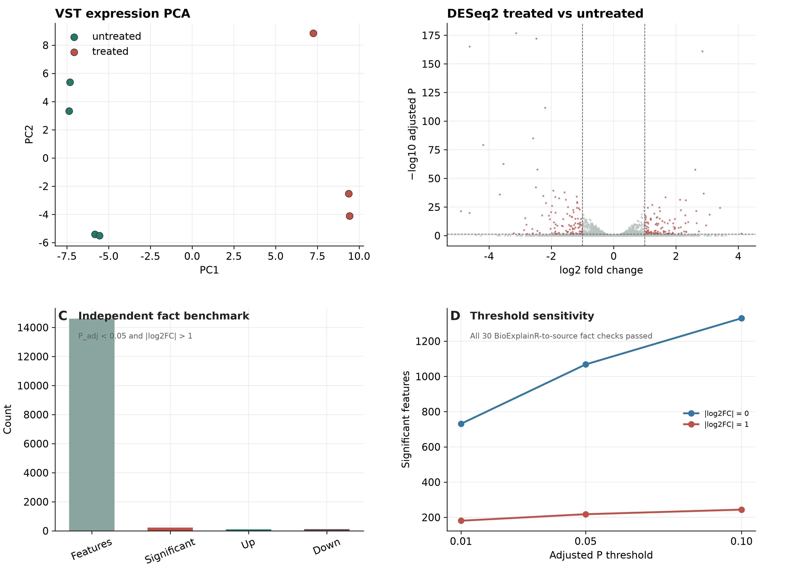
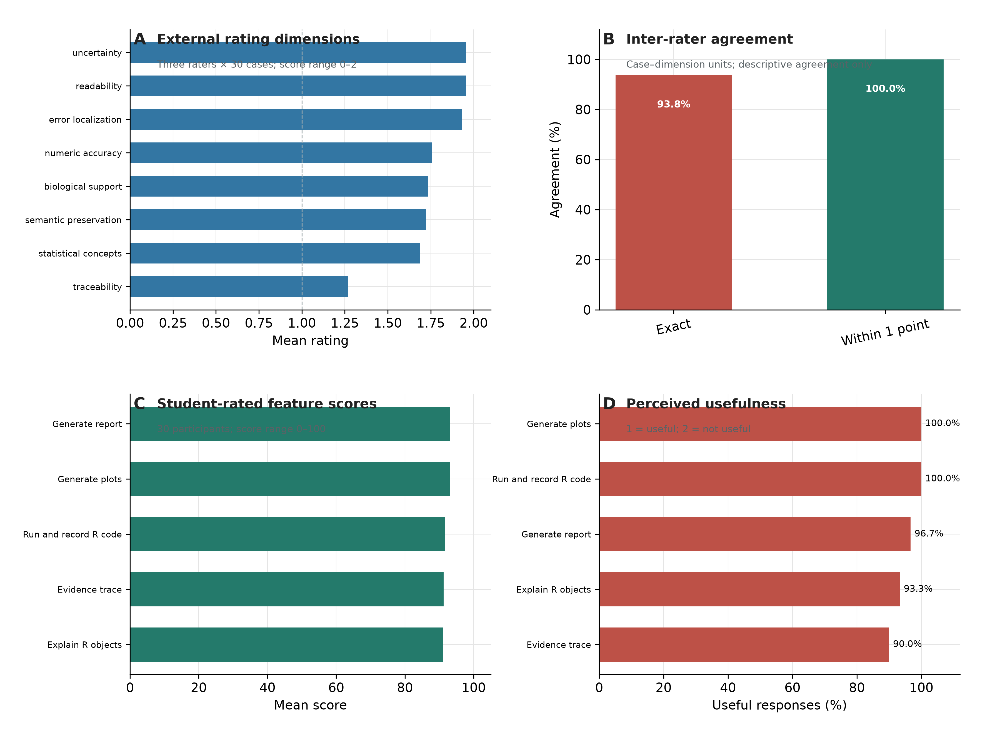

# S1 数据、软件与复现方法

## 数据来源与预处理

本研究使用五个公开数据集作为对象接入和事实提取案例。airway/GSE52778 使用 airway 1.22.0 的计数对象，以细胞系作为配对项，设计 `~ cell + dex`，比较 `trt vs untrt`。PBMC3k 使用 10x Genomics 公开过滤矩阵；从对象元数据计算每细胞 UMI 数、检测基因数和线粒体比例，并构建 SingleCellExperiment 与 SeuratObject 对象。pasilla 作为未参与 airway/PBMC3k 开发的独立 DESeq2 事实核对。新增的 ALL 1.44.0 和 bladderbatch 1.40.0 为带有固定 Bioconductor 归档的 Biobase `ExpressionSet`，分别用于对象、分组和批次字段摘要。计数、模型和图形结果均由 R 脚本生成，不使用合成教学数据。

Reactome Ensembl 映射快照 SHA-256 为 `34852dc2ac258a851bad914708c0045a636161dbbeca604f04343174cca8d7fb`；PBMC3k tar.gz 为 `847d6ebd9a1ec9a768f2be7e40ca42cbfe75ebeb6d76a4c24167041699dc28b5`。新增的 ALL、bladderbatch、tximportData 和 RNAseqData.HNRNPC.bam.chr14 归档 SHA-256 分别为 `6c52471acf4bb77ed86e71c25e69ce5cc5235acec50785107b212934c6eec5db`、`74e7a300c2d2835f0dc82d70f9e90af55e7a5d248e7364a80b9e6bdd57dbafa5`、`0f8218398e976c5930ecebf45663feba4af8b8f165d47f01f91f4fbade78554f` 和 `ee88ed18b7f6d6ebbf827c91102a0fa6c2ad67e6eb090ce311692c2be7d2bcbd`；以 `download_manifest.csv` 为准。地址、访问时间、airway 计数对象摘要及依赖版本保存在 `research/results/data_manifest.json` 和 `research/results/public_datasets/`。Reactome 的 current 地址会更新，严格重现需要相同校验值的快照；重新下载不保证获得相同输入。

验证环境为 Ubuntu 24.04、R 4.3.3，软件 BioExplainR 0.3.1；实际对象依赖为 DESeq2 1.42.0、limma 3.58.1、edgeR 4.0.16、SingleCellExperiment 1.24.0、SeuratObject 5.0.1、uwot 0.1.16、Matrix 1.6-5、ggplot2 3.4.4 和 Biobase 2.62.0。独立 pasilla 基准使用数据归档 1.30.0、DESeq2 1.42.0；新增归档为 ALL 1.44.0 和 bladderbatch 1.40.0。相近工具入口测试使用 iSEE 2.14.0、GPTCelltype 1.0.1 和 ellmer 0.5.0。接口支持列表不是这些包所有版本的验证矩阵。

从项目根目录运行：

```sh
R CMD INSTALL .
R --vanilla --slave -f research/prepare_real_data.R
# 模型实验需要进程环境变量 DEEPSEEK_API_KEY
R --vanilla --slave -f research/run_model_experiments.R
R --vanilla --slave -f research/summarize_results.R
R --vanilla --slave -f research/audit_results.R
# 五数据集对象/摘要检查
R --vanilla --slave -f research/test_public_datasets.R
```

服务器的 `bash tools/server-R` 可替代 `R`；临时 runtime 不随源码交付。模型脚本默认复用已保存响应并重新验证，以免重复付费。新的独立评测应冻结软件版本、提示、案例、评分容差和模型配置，并单独归档新一轮记录。大型下载与 R 对象保存在 Git 忽略的 `research/cache/`，不嵌入补充文档或记录压缩包。五数据集的固定归档、SHA-256、对象类、任务和状态保存在 `research/results/public_datasets/download_manifest.csv` 与 `dataset_tests.csv`。

# S2 相近工具与独立 pasilla 基准

## 评价方法

相近工具测试与 BioExplainR 使用独立的临时 R 库。iSEE 2.14.0 在真实 PBMC3k `SingleCellExperiment` 上初始化已有 UMAP 与 QC 颜色面板；Playwright 预先检查 `ReducedDimensionPlot1_Type=UMAP`、坐标轴 1/2、`mito_qc` 颜色变量和图像加载。GPTCelltype 1.0.1 从真实抽样细胞、3 个 k-means cluster 和 marker 表构造提示，不提供在线 key，因此不评价细胞类型预测。ellmer 0.5.0 与 BioExplainR 各重放 6 个保存 prompt，通过自包含本地 replay 服务比较响应文本。btw 未安装，不进入性能比较。完整记录见补充表 S2。

pasilla 1.30.0 归档用于未参与 airway/PBMC3k 开发的数值基准。DESeq2 设计为 `~ type + condition`，比较 treated vs untreated。预设 P_adj 0.01/0.05/0.10 与 |log2FC| 0/1 的 6 个组合，将 BioExplainR 事实和直接源表计算的特征数、显著数、上下调数和缺失校正值逐项比较，共 30 项事实。归档 SHA-256、逐项结果及计算来源见补充表 S2-S3。

五数据集测试脚本 `research/test_public_datasets.R` 的结果为 5/5 pass：airway 的 DESeqResults 摘要、PBMC3k 的 SingleCellExperiment 摘要、pasilla 的独立 DESeq2 事实基准、ALL 的 ExpressionSet/BT 摘要以及 bladderbatch 的 ExpressionSet/癌症组/批次摘要。ALL 为 12,625 特征 × 128 样本、10 个观察到的 BT 分组；bladderbatch 为 22,283 特征 × 57 样本、3 个癌症分组和 5 个批次。该矩阵验证对象接入和确定性摘要，不验证跨数据集生物学重复性。

## 评价结果

iSEE 的真实 `SingleCellExperiment` 入口初始化和浏览器图形检查通过；GPTCelltype 的真实 marker 到提示构建通过；ellmer 与 BioExplainR 的保存响应 replay 共 12/12 次保持文本一致；btw 未安装。pasilla 归档包含 14,599 个特征和 7 个文库，6 个阈值组合的 30 项事实核对全部通过；P_adj < 0.05 且 |log2FC| > 1 时为 218 个显著特征（108 上调、110 下调），P_adj 缺失 5,800 个。补充图 S2 展示 PCA、火山图、计数和阈值敏感性；补充表 S3 保留六组逐项值。这些结果是入口兼容性和事实提取结果，不是相近工具性能排名或独立模型解释质量评价。

::: {.paper-table #table-S2}
:::

::: {.paper-table #table-S3}
:::

{width=17cm}

**补充图 S2. 独立 pasilla 基准。** (A) VST 表达 PCA，按 condition 着色；(B) DESeq2 treated vs untreated 结果，颜色标出 P_adj < 0.05 且 |log2FC| > 1 的特征；(C) 该阈值下的特征、显著、上下调计数；(D) 不同 P_adj 与 |log2FC| 阈值下的显著特征数。图形用于数据基准和工作流展示，不作为新的生物学结论。

# S3 主实验方法、评分和原始记录

## 实验方法

固定服务为 `https://api.deepseek.com`，OpenAI-compatible，模型请求及返回字段均为 `deepseek-flash`，thinking disabled，temperature = 0，JSON mode，主实验输出上限 5,000 tokens、timeout 120 s，瞬时错误最多重试一次。该模型别名没有不可变快照编号。实验时间为北京时间 2026-10-04，原始 UTC 时间为 2026-10-03。

主实验包含 120 个可复现案例、480 个唯一标量目标：差异表达 30 个、富集 20 个、PCA 20 个、SingleCellExperiment 20 个、细胞组成 15 个、generic 表格摘要 15 个；每案例四个目标。参考值由 BioExplainR adapter 从完整对象计算，保存于 `research/results/main_scale_480/reference_facts.json`，逐项返回值、是否回答和是否匹配保存于 `fact_scores.csv`。

匹配评分对非零数字使用 10^-6 相对容差，对零使用 10^-6 绝对容差，字符串精确匹配。每方法 360 次请求、1,440 次评分，三方法合计 1,080 次请求、4,320 次评分；共享案例与重复调用不视为独立生物学样本。默认事实摘要路径将完整 R facts 和最多 10 行 top-feature 预览传给模型；`direct_bounded` 仅提供有限原始结构，作为信息受限基线。消融图按每轮 480 项聚合，均值与样本标准差只作描述，不实施泛化显著性检验。

## 结果记录

规模主实验响应在 `research/results/main_scale_480/model/{case}__{method}__{replicate}.json`，共 1,080 个响应和 1,080 个提示文件，保留响应文本、解析结果、模型字段、时间、usage 及检查状态。调用级表为 `main_scale_480/model_calls.csv`，逐事实评分为 `main_scale_480/fact_scores.csv`，汇总为 `main_scale_480/ablation_summary.csv` 和 `family_summary.csv`。旧的 25 事实主实验和预实验仍以历史记录保存，不与本轮规模结果合并。

随附 `supplementary_records.zip` 包含上述原始记录、主实验/预实验评分、JSON 清单、挑战结果及浏览器截图，逐文件相对路径、大小与 SHA-256 见同目录 `supplementary_manifest.csv`。索引只用于定位，原始生成文本保持原样；模型输出本身不作为事实真值。

# S3b 双模型与代码代理共同任务

## 共同任务方法

为补充主实验，使用相同的 120 个案例、480 个预定义标量事实和评分规则，分别运行 StepFun `step-5-preview` 和 DeepSeek `deepseek-flash` 各一次。两个模型均通过 OpenAI-compatible 接口调用，temperature = 0，最多 800 个输出 token，最终运行均关闭 `response_format = json_object`。两者接收完全相同的输入和 prompt，使用相同的输出预算、单次逐案例调用方案、fact-path/数值容差/覆盖率评分程序和同一批案例；因此协议差异仅限于服务端点和模型本身。Facts JSON 保留 17 位数字，提示要求非整数小数作为完整字符串逐字符复制。此前 25 事实版本和 JSON mode 格式探针单独归档，不纳入当前结果。

## 共同任务结果

StepFun 和 DeepSeek 均有 480/480 个目标事实回答，严格匹配均为 480/480（100%），覆盖率均为 100%（补充表 S4）。定向 PCA 20 案例/80 目标及完整 120 案例/480 目标均通过；此前四位小数失配来自模型输出精度不足，已由完整精度 Facts 和字符串复制规则修复。

::: {.paper-table #table-S4}
:::

# S4 预实验与开发迭代

## 预实验方法

首轮预实验使用相同六案例、三方法、三次重复，输出预算为 2,600 tokens。PCA 适配器当时将方差比例提前舍入为四位小数；完整子表基线允许达到输出 token 上限。预实验与主实验使用相同的参考事实和评分框架，但预实验记录不合并到主实验。

## 预实验结果与开发影响

两种事实方法各为 69/75 匹配，其中 PCA 严格评分不匹配来自输入精度损失。预实验的完整子表基线一次达到输出 token 上限，未形成完整 JSON；截断响应仍在 `research/results/pilot_precision/model/`，未被删去。

随后系统保留 PCA 原始比例，将输出预算提高为 5,000 tokens，并要求更简洁的结构化声明；规模主实验进一步在 120 案例、480 目标事实上运行。相应原始配置见两轮 `experiment_manifest.json`、提示和 usage。预实验与规模主实验不合并计数；共同任务的模型响应另保存在 `research/results/common_task_scale_480/`。

这轮调整基于后续报告中的同一批数据，构成开发集乐观偏倚。规模主实验事实方法 1,440/1,440 是已传入 R 计算事实后的接口传递结果，不是冻结后的独立泛化结果，也不能把修复前后的差异单独归因为模型改进。下一阶段应冻结包、提示、案例和评分，在未参与开发的数据上进行预先规定的评测。

# S5 外部评分者与功能感知评价

## 评价方法

3 位外部评分者分别对 30 个去来源化解释案例的 8 个维度使用允许 0–2 分的量表，共 720 条记录。评分者只看到匿名解释和统一任务说明，不看到原始数据集、模型、方法或作者身份。完全一致率定义为每个案例-维度中 3 位评分者分值相同的比例；相差不超过 1 分作为描述性指标，不计算 ICC 或 kappa。另由 30 位评分参与者对 5 项功能给出 0–100 分，并选择“有用/没用”；该表不包含任务正确率或对照组。

## 评价结果

当前保存的聚合结果不包含招募方式、评分者资历、知情同意、补偿或伦理审查流程记录；本批记录只出现 1 分和 2 分，没有 0 分记录。总体评分均值为 1.751/2；数字准确性、统计概念、生物学支持、可追溯性、不确定性、可读性、错误定位和语义保持的均值分别为 1.756、1.689、1.733、1.267、1.956、1.956、1.933 和 1.722。以每个案例-维度为单位，3 位评分者完全一致率为 93.75%，相差不超过 1 分的比例为 100%。

30 位评分参与者完成 5 项功能的 150 条评分，无缺失。总体均值为 91.98/100，144/150（96.0%）标记为有用；运行并记录 R 代码、解释 R 生物信息学对象、生成常用分析图形、证据与来源追踪和生成分析报告的均值分别为 91.57、91.00、93.03、91.23 和 93.07。证据与来源追踪的有用比例为 90.0%，其他功能为 93.3%-100.0%。

::: {.paper-table #table-S5}
:::

{width=17cm}

**补充图 S3. 外部评分者与功能感知评价的聚合结果。** (A) 外部评分者对八个维度的均值；(B) 以 case-dimension 为单位的完全一致和相差不超过 1 分比例；(C) 评分参与者对五项功能的平均分；(D) 评分参与者标记为有用的比例。图仅展示聚合描述统计，不替代参与者招募、知情同意、伦理审查或预先注册的用户研究。

# S6 解释案例与语义负例

文件 `research/results/model/airway_lfc1__facts_evidence__1.json` 保存了一个完整 airway 响应。其五条显式数值声明为：22,369 个特征、999 个显著特征、519 个上调、480 个下调、5,204 个缺失校正值；数值与事实路径均匹配，验证状态为 `pass`。模型引用 `EuropePMC:MED:24926665`，属于给定证据集合。

同一响应的 `uncertainty` 第一项原文为：

> log2FC 似乎经过收缩（shrinkage），收缩后的效应量更保守，适合排序和可视化。

该措辞不符合实际流程：`prepare_real_data.R` 使用 `DESeq2::results()`，没有执行 `lfcShrink()`，其来源描述为 MLE。因此这是保存响应中的语义负例，说明数字与引用 ID 检查通过不代表其他文字正确。本稿没有删除或把该响应改写成完美示例，也没有据此估计全部响应的自由文本错误率；后者需要预先定义标准并系统评审。

还应区分 17,165 个非缺失校正 P 值与实际原始检验数。保存的兼容性结果表明该对象原始 P 值缺失数为零；适配器字段 `n_tested` 在这个对象中对应可用校正值计数，不能仅据其名字解释成“实际参与原始检验”。5,204 个 P_adj 缺失值不等于没有变化，也不能一概解释为没有进行检验。

当前 ORA 的唯一 BH 显著通路是 R-HSA-6785807，集合重叠 16 个基因。这个统计事实不证明通路活性改变。Europe PMC 记录为可追溯入口，全文支持关系没有经过专家评价；向 PBMC/PCA 提供同一 airway 文献只构成引用闭集挑战，不构成适用性验证。

# S7 机制挑战与浏览器记录

声明挑战在 18 个事实加证据响应上下文分别注入错误数字、未知事实路径、向量冒充标量、未提供引用和仅路径无值，共 90 项；前四类 72 项全部 `fail`，最后 18 项 `partial`，移除检查器为 `unchecked`。`partial` 来自引用检查已通过而事实值未验证的组合。逐项内容在 `validation_ablation.csv`，汇总在 `validation_summary.csv`。

图形挑战保留正确火山图、PCA 和富集图，再注入方向反转、原始 P 值替换、PCA 坐标改变、轴标签改变、富集大小改变和颜色改变；期望及结果在 `plot_challenges.csv`，详细发现为 `plot_findings.json`。参考水平修复两项均可运行，只有保持 `untrt` 参考的代码通过事先声明的因子水平与行数不变量；记录为 `fix_validation.json`。挑战均是构造的机制测试，不是自然发生错误率。

浏览器测试记录 `browser/summary.json` 列出 11 个工作流步骤，包括代码执行、真实 DESeq2 解释、HTML 下载、PCA 渲染/回写与源核对、DeepSeek 页面调用、SCE/Seurat 解释、双连接隔离及移动横向溢出检查。桌面为 1,440 × 1,000，移动为 390 × 844 视口，另有完整页面截图。结果为 pass，JavaScript 异常和失败资源为空。iSEE 的独立浏览器记录 `related_tools/iSEE_browser.json` 进一步检查真实 UMAP panel DOM 与图像加载。截图保留在原始文件名下；自动像素检查不等于人工视觉评价，也不证明真实用户收益。

软件检查记录为 `R-CMD-check.txt`。本文报告的是已保存运行结果，后续论文排版验证不会被当作新一轮软件功能实验。

# S8 投稿准备信息

当前中文稿按中等方法期刊的组织原则整理，尚未宣称满足某一期刊的全部投稿要求。英文翻译后应核对目标期刊的摘要字数、章节、图表数量、引用和声明格式；中文摘要采用连续叙述，不把“200-250 英文词”机械套用到中文。

作者须补齐真实姓名、单位、通讯方式、贡献、经费、利益冲突、公开仓库与版本化 DOI。当前代码采用 MIT 许可证，但公开发布并未在本轮完成。共同任务为两个模型各一次、120 个共享案例和 480 个目标事实；这些案例是可复现程序生成输入，不是独立生物学样本。多个代理的隔离执行、专家盲评及真实用户研究仍是待开展工作，不能由写作补足，也不能作为已有结果。

正文图 1-4、表 1-8 与补充图 S1-S3、表 S1-S5 集中于主稿或补充材料附录；单独 PDF/Excel 在 `docs/submission_assets/`。每个组合图的 panel 另有独立 PDF/PNG/SVG。英文标签仅为后续复用，本文仍是中文初稿。记录压缩包不包含 API key 或大型原始对象缓存；外部评价仅以聚合结果进入项目；全部原始生成文本仍需由署名作者审阅。
