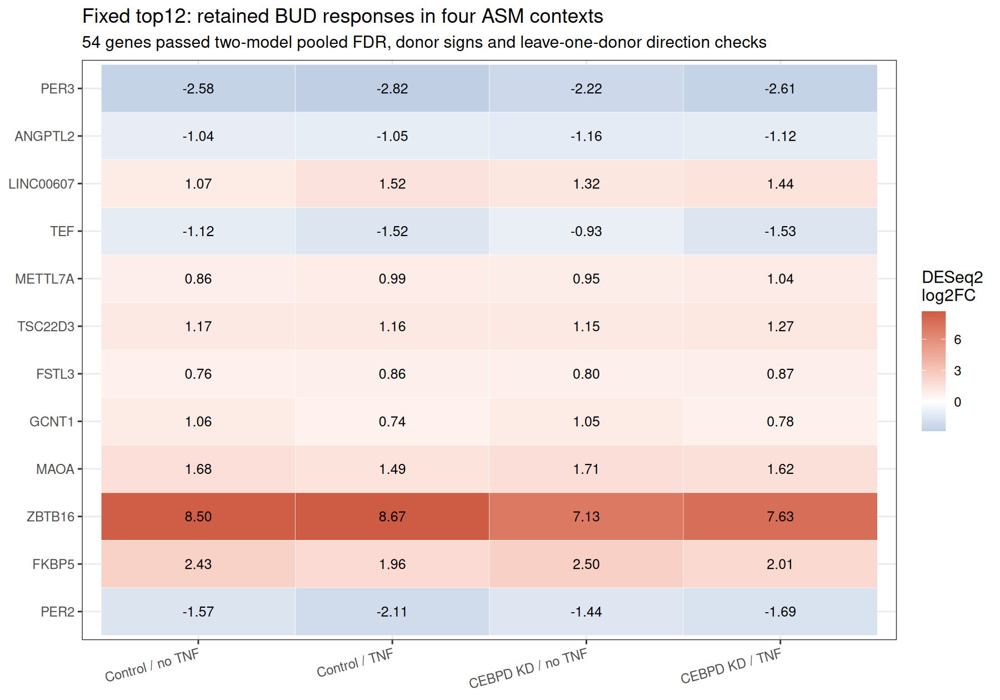
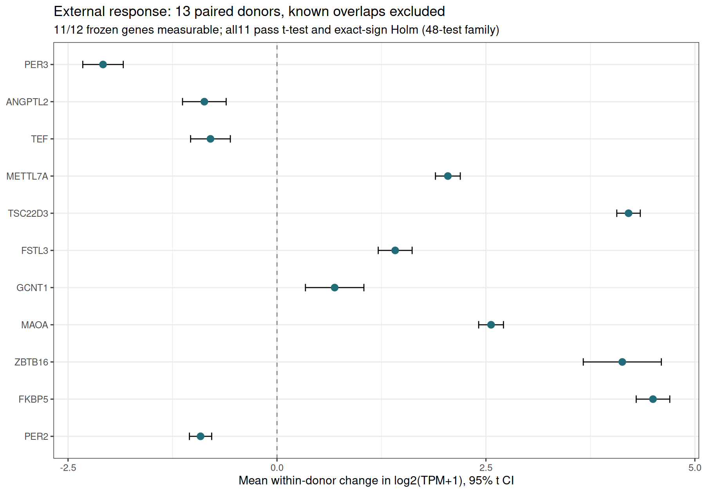
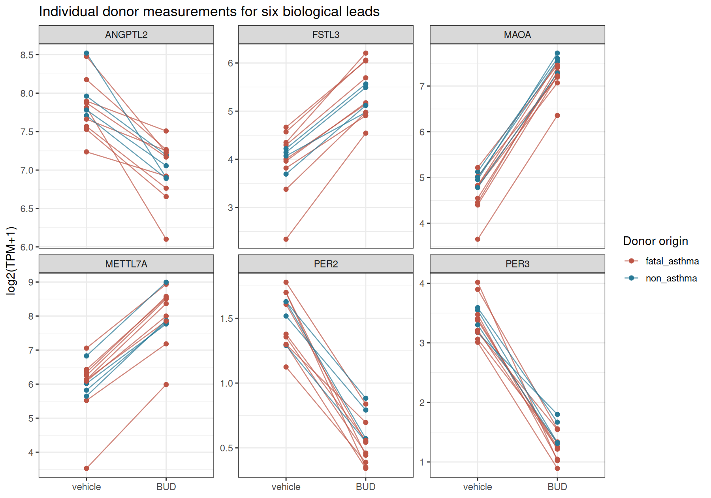
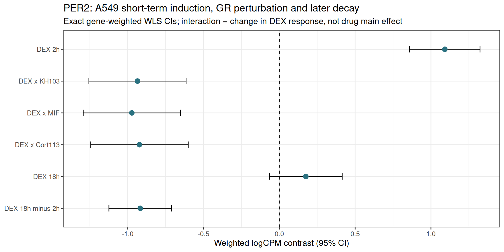
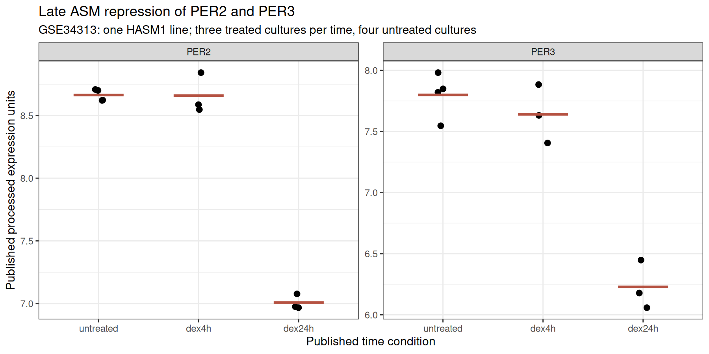

# BioExplainR 生物学发现结果：稳健激素响应与PER2时间依赖线索

2026-10-09；所有统计取自保存结果，探索性公共数据重分析。

## 核心结果

本轮实际筛查27,409个基因，得到54个在四种TNFα／CEBPD敲低背景保留的布地奈德响应基因。固定排名前12个后，再读取外部候选数据；11个可测基因在排除已知重叠的13供体中全部重复，t检验与精确符号翻转均通过48项Holm校正。第12个LINC00607缺外部注释，保留不可估计，未换候选。

最值得继续验证的新增整合线索是PER2：18 h/24 h成人ASM下调，A549 2 h上调且受GR药物干预削弱，18 h时回落。直接时间差在两个实验中均通过校正。可支持“时间／实验环境依赖的PER2响应”，不能直接解释为组织特异或昼夜节律功能损伤。

第二组实测线索是METTL7A和MAOA的稳定上调及较晚时点的进一步增加；ANGPTL2、FSTL3提供相反方向的细胞外信号候选。该表只支持转录响应，蛋白、信号和功能尚不能由表达替代。

表1：全部固定12候选。外部效应为log2(TPM+1)配对差，与发现log2FC采用不同尺度；缺测保留原48项分母。

|基因|四背景log2FC|13供体效应|95%CI|Holm P|供体方向|

|---|---|---|---|---|---|

|PER3|-2.818 至 -2.217|-2.082|-2.324 至 -1.839|1.24e-08|0↑ / 13↓|

|ANGPTL2|-1.162 至 -1.038|-0.869|-1.131 至 -0.608|0.000303|0↑ / 13↓|

|LINC00607|1.067 至 1.517|不可估计|不可估计 至 不可估计|1|未测得|

|TEF|-1.526 至 -0.926|-0.796|-1.034 至 -0.558|0.000295|0↑ / 13↓|

|METTL7A|0.864 至 1.038|2.044|1.896 至 2.193|5.31e-11|13↑ / 0↓|

|TSC22D3|1.154 至 1.268|4.206|4.066 至 4.347|5.41e-15|13↑ / 0↓|

|FSTL3|0.765 至 0.868|1.414|1.211 至 1.617|1.34e-07|13↑ / 0↓|

|GCNT1|0.742 至 1.059|0.690|0.340 至 1.040|0.0237|12↑ / 1↓|

|MAOA|1.490 至 1.708|2.561|2.413 至 2.710|3.7e-12|13↑ / 0↓|

|ZBTB16|7.130 至 8.672|4.132|3.664 至 4.599|9.05e-09|13↑ / 0↓|

|FKBP5|1.962 至 2.497|4.499|4.298 至 4.700|1.71e-13|13↑ / 0↓|

|PER2|-2.108 至 -1.441|-0.915|-1.048 至 -0.782|1.55e-07|0↑ / 13↓|

## 数据与固定分析流程

发现集GSE146017：4供体／31文库，~ donor + kd * bud * tnf；保留原DESeq2模型、过滤、size factors及dispersion。另从原计数运行edgeR TMM、limma voom/eBayes，四背景simple effects各自全family BH。候选需baseMean≥10、四条件绝对log2FC≥0.5、两模型显著同向、每可用供体方向一致、四次留一供体方向一致；按最弱绝对Wald stat排序。

外部GSE94335：原Table E1核实配对，维持28793/28796排除；再排除N010912、N051911、N061311，剩13供体（4非哮喘、9致死性哮喘）。汇总每基因所有转录本TPM，以log2(TPM+1)计算供体配对差。12基因×合并／两病组／组差4项，共48项Holm；缺测P=1纳入分母。保存8192/512/16符号翻转、715组枚举及0.1/0.5/1伪计数敏感性。

机制GSE229084：原47文库／4批次A549模型，固定表达过滤。12候选×DEX及3药物交互为48项Holm，精确逐基因WLS协方差和原moderated方差/df。时间增补在初步结果后制定：单HASM1 GSE34313 DEX 4 h/24 h、A549 DEX 18 h及直接时间差；均标记探索性，未把追加分析写为初始预定检验。

## 发现一：PER2/PER3的晚期抑制与PER2暂态诱导

PER2在发现四背景log2FC −2.108至−1.441；外部13/13供体下调，平均log2(TPM+1)差−0.915（95%CI −1.048至−0.782，Holm P=1.55×10⁻⁷，精确Holm P=0.0117）。PER3同样13/13下调，外部效应−2.082（CI −2.324至−1.839，Holm P=1.24×10⁻⁸）。两个基因的供体方向在三种伪计数和全部留一供体中保持。

HASM1中PER2在4 h接近零，24 h为−1.656（24检验Holm P=1.24×10⁻⁴）；直接24 h−4 h为−1.651（95%CI −1.997至−1.305，24检验Holm P=0.0139）。PER3直接时间差−1.412（Holm P=0.0195）。培养重复的小样本置换在全family校正后不能确认这些时间结果，因此此段是参数模型支持的探索性追踪。

A549 PER2 DEX 2 h +1.092（CI 0.860至1.323，48检验Holm P=5.71×10⁻¹⁰）；KH-103/MIF/Cort113交互分别−0.935/−0.972/−0.922，Holm P均<4.05×10⁻⁵。DEX 18 h效应+0.175、Holm P=0.442；直接18 h−2 h为−0.917（CI −1.124至−0.710，24检验Holm P=1.45×10⁻⁹）。这揭示暂态与长期效应的混杂，尚不能区分时间、药物、剂量、培养环境和细胞类型。

表2：PER2精确WLS。2 h及交互使用48项family，18 h为探索增补12项family。

|PER2对比|效应|95%CI|Holm P|

|---|---|---|---|

|A549 DEX 2 h|1.092|0.860 至 1.323|5.71e-10|

|DEX×KH-103|-0.935|-1.255 至 -0.615|2.98e-05|

|DEX×MIF|-0.972|-1.293 至 -0.652|1.49e-05|

|DEX×Cort113|-0.922|-1.244 至 -0.601|4.04e-05|

|A549 DEX 18 h|0.175|-0.065 至 0.415|0.442|

表3：直接晚−早差；同一24项Holm family，单位为各实验原log尺度，不跨实验合并。

|基因|实验|时间差|效应|95%CI|Holm P|

|---|---|---|---|---|---|

|PER3|ASM|24 h−4 h|-1.412|-1.918 至 -0.906|0.0195|

|PER3|A549|18 h−2 h|-0.389|-0.784 至 0.005|0.423|

|METTL7A|ASM|24 h−4 h|1.231|0.912 至 1.550|0.00799|

|METTL7A|A549|18 h−2 h|2.026|1.577 至 2.474|9.01e-10|

|MAOA|ASM|24 h−4 h|2.889|2.376 至 3.402|0.0028|

|MAOA|A549|18 h−2 h|2.364|2.107 至 2.621|3.52e-19|

|PER2|ASM|24 h−4 h|-1.651|-1.997 至 -1.305|0.0139|

|PER2|A549|18 h−2 h|-0.917|-1.124 至 -0.710|1.45e-09|

## 发现二：可重复的非经典候选

METTL7A在外部13/13供体上调，效应+2.044（CI 1.896至2.193，Holm P=5.31×10⁻¹¹）；MAOA同样13/13上调，+2.561（CI 2.413至2.710，Holm P=3.70×10⁻¹²）。两个基因在HASM1 24 h和A549 18 h均上调，其直接晚−早时间差在两个模型中均通过24项Holm，提示较晚表达累积值得研究。其GR药物交互未通过48项Holm，不能宣称已验证受体依赖。

ANGPTL2在外部13/13供体下调（−0.869，Holm P=0.000303），HASM1 24 h亦下调；A549未通过原表达过滤。FSTL3在外部13/13上调（+1.414，Holm P=1.34×10⁻⁷），A549 DEX 2 h/18 h上调；HASM1 24 h与GR交互未通过各自Holm。可提出细胞外信号响应候选，不能将ANGPTL2与FSTL3直接拼接为已验证的功能通路。

LINC00607在四背景上调1.067至1.517，两模型及供体敏感性通过；旧airway DEX18 h结果为−0.082、BH P=0.915，外部缺注释。这是条件特异待复核候选，尚无独立重复。TEF虽在13供体下调，但单HASM1微阵列不重复，保留该不一致。FKBP5/TSC22D3为已知GR阳性控制。

## 阴性结果、文献与新颖性

初始全基因三个交互×27,409基因共82,227检验，无一通过pooled BH（最小0.3515）。不降低阈值取阳性；无显著交互不证明CEBPD/TNF完全无效或四背景等效。外部病组差亦未通过48项Holm，不证明两组等效。

已保存15个Europe PMC查询及原论文段落核对。原文明确提到FKBP5/TSC22D3为已知响应基因；2021年胎儿ASM节律研究（doi:10.1152/ajplung.00406.2020）已经研究DEX与PER2等节律机制。2025年跨组织GR转录组研究亦提供已有背景（doi:10.1186/s12864-025-11676-w）。因此不主张发现“激素调节生物钟”这一大主题首次存在。

LINC00607与BRG1/ERG的内皮功能已经有2023年原文（doi:10.1007/s00395-023-00978-3）；本轮仅提出其ASM药物响应待验证。新颖性可定位于固定全基因稳健筛选、排除重叠供体、候选分布及GR/时间综合证据。全文检索有两项HTTP500失败记录，未宣称全面文献覆盖。

## BioExplainR实际应用及数值核验

实际载入BioExplainR 0.4.0.9000源码，建立9个context及项目，生成中文／英文离线HTML。四背景每个27,409行全表显著计数与独立计数分别151/185/128/149完全一致，82,227行交互计数为0。报告v2修正uncertainty字段及混合实验scope，v1保留为被取代版本。

Python独立核对82,227交互、109,636响应的BH及Wald/CI，192供体记录（180可估计、12缺失），300项精确GR WLS数值、110原微阵列测量和24直接时间检验；独立R从5,851,434行原TPM及原配对补充表复核286测量、143供体效应、44可估计检验与48项分母，360统计检查通过。拟合参数来源保留，未称跨语言重新估计DESeq2 dispersion或limma moderation。

统计由DESeq2/edgeR/limma完成，BioExplainR负责完整事实、scope、项目和报告。在线模型调用为0；成果为公共数据实际重分析。

## 可直接执行的后续验证

优先线索：成人ASM中PER2/PER3短时与晚时激素响应。采用匹配vehicle的0/2/4/8/12/18/24/36 h时间序列、独立供体与GR干预，分别测PER2/PER3 RNA和蛋白；先检验暂态诱导与晚期抑制，随后才能拟合节律相位/振幅。

次级线索：METTL7A/MAOA的较晚累积响应和ANGPTL2/FSTL3细胞外信号。以供体为单位复核表达及蛋白，再作相应干预与功能终点；LINC00607先核实原计数注释、异构体和qPCR特异性。当前交付已经包含具体数值、供体记录、完整结果表及图稿。

## 结果图稿

图1：四种ASM背景中的固定12候选响应。格内为DESeq2 log2FC；所有候选通过两模型全family BH及供体方向要求。LINC00607名称另由Ensembl核对，外部未测得。

图2：排除3个已知重叠细胞系后的13供体配对效应与95% t区间。11个可测基因均通过48检验Holm，不能据此确认TNF/KD交互。

图3：六条重点线索的逐供体原始测量。每线是一个供体，不把两文库计为两人。

图4：PER2在A549的短时DEX上调、三项GR药物交互及长时回落。交互为DEX响应差中差；95%CI使用精确逐基因WLS协方差。

图5：单HASM1细胞系的PER2/PER3处理时间条件。直接24 h−4 h比较已检验，而非以两组显著性不同推出时间差。
