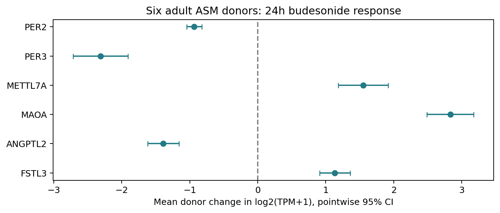
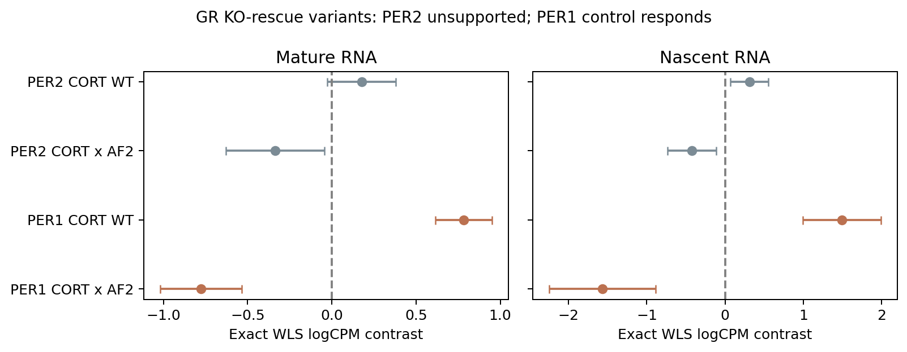
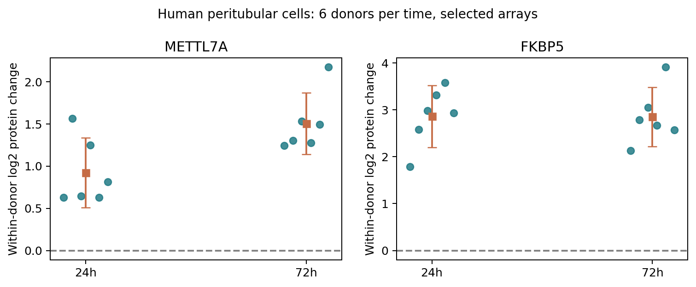

# 公开数据验证增补：成人ASM响应、GR遗传交叉检验与人源蛋白证据

2026-10-09｜结果后探索｜全部采用公开数据｜新增3个ASM表达实验、GR两类RNA及蛋白数据核对

## 1 本轮结论

完成了新增公开数据分析，而不仅是方案：GSE130715六名成人供体、GSE13168三名可配对供体及GSE135730早期ASM培养实验；另分析GSE342887/342771的GR敲除背景下野生型与突变体rescue，以及PXD081613蛋白组和人源HTPC蛋白补充表。

PER2晚期下调在新增六成人ASM供体中重复；早期ASM诱导、统一成人逐时方向反转及PER2受体遗传依赖尚未得到确认。新的蛋白层面线索集中在METTL7A：成人睾丸管周平滑肌样细胞的24/72h DEX处理均6/6供体上调，但这属于跨组织、原文选中数组的探索性支持。

六重点候选在新增成人ASM的24h BUD响应全部方向一致并通过配对t的44项Holm；同供体计数模型亦支持。精确小样本符号翻转校正未确认，完整保留。所有GNAS/PKI交互均未通过各自Holm，不能据此声称受体机制或等效。

## 2 资料与检索范围

初始4个GEO查询得到31个唯一series，6个EuropePMC查询完整分页保存；扩大受体遗传/蛋白检索又保存194个唯一series汇总及115条文献命中记录。检索只是范围限定的可用性检查，不证明其他资料不存在。原计数/TPM/SOFT/RPKM、原文HTML/XML、PRIDE数据和失败响应均保存。

成人时间证据来自Bartman等2021[1]。六新ASM供体年龄19–54岁由Nuñez等2020表1与GEO双源确认[2]；六label与旧GSE94335已核对label无exact重叠，但未知别名未完全排除，不累加供体数。其他匿名培养系或年龄未公开的数据只写实验重复。

本文是公开数据再分析；所有候选基于既知v0.11主线固定，新增比较方案在各新表达读取前冻结，人体蛋白选中数组重算及ortholog映射增补明确标记结果后探索。统计完成范围与待确认机制分开记录，负责人无需新增湿实验。

## 3 新增成人ASM晚期响应

GSE130715包含六成人×GNAS siRNA/对照×1µM BUD/vehicle，共24文库、28,395基因。配对主估计量是log2(TPM+1)差；11候选/控制×4比较，44项Holm。供体是n=6，文库不是独立人。新TMM/voom过滤保留14,692基因，~donor+kd*gc，秩9、残差df15；精确逐基因WLS作为敏感性。

表1 六重点基因的新成人ASM响应。两列效应单位不同：TPM对数差与加权logCPM；同源两模型不增加独立证据数。

|基因|供体配对效应|点态95%CI|Holm44 P|方向|计数模型效应|计数Holm44 P|

|---|---|---|---|---|---|---|

|PER2|-0.934|-1.044至-0.824|0.000157|0↑/6↓|-1.405|3.54e-08|

|PER3|-2.311|-2.714至-1.908|0.00096|0↑/6↓|-3.020|2.39e-08|

|METTL7A|1.552|1.184至1.921|0.00373|6↑/0↓|1.630|1.74e-10|

|MAOA|2.832|2.486至3.178|0.000184|6↑/0↓|3.023|1.26e-14|

|ANGPTL2|-1.388|-1.620至-1.157|0.000786|0↑/6↓|-1.401|6.44e-08|

|FSTL3|1.135|0.908至1.361|0.0017|6↑/0↓|1.219|5.65e-09|

图1 六成人逐供体差的均值与点态95%CI。所有六候选均6/6方向一致；精确符号翻转原P=.03125、44项Holm=1。

PER2 −0.934（CI −1.044至−0.824，Holm=.000157）；GNAS×BUD交互+0.224（CI −0.166至+0.615，Holm=1）。原计数WLS的PER2响应−1.405、Holm=3.54e−8，交互+0.377、Holm=1。敲低靶点GNAS RNA −2.462、6/6降低，表明干预发生，但不能把GNAS改称GR。

## 4 成人时间序列与早期ASM反证

补回原文中真正的成人ASM部分：3女/3男、33–77岁来源池；DEX100nM或vehicle脉冲30min后洗去，12/16/20/24h匹配采样[1]。作者文字描述PER2升高，但表2只有DEX组24h−12h为Tukey P=.0498；同24h DEX−vehicle为.7831。时间变化不等于药物×时间交互；没有原个体Ct/协方差，未重算新效应、CI或交互。

表2 PER2时间条件核对。不同研究药物、剂量、培养、同步化和测量尺度不同，逐行读，不能拼接为同一供体时间曲线。

|来源／估计目标|PER2效应|校正P|独立单位与限制|

|---|---|---|---|

|GSE135730，4h DEX−UT|0.111|1|3培养/组；年龄及供体ID未知|

|GSE13168，8h FP−vehicle|0.691|1|3配对供体；年龄/别名未知|

|Bartman2021，24h DEX脉冲−同时间vehicle|原个体Ct未取得|0.7831（原Tukey）|成人ASM；30min脉冲；n4–6/条件|

|Bartman2021，DEX组24h−12h|原个体Ct未取得|0.0498（原Tukey）|时间差；不是药物×时间交互|

|GSE130715，24h BUD−vehicle|−0.934|0.000157（Holm44）|六成人配对；单晚期终点|

GSE13168 8h FP的PER2 +0.691、3/3↑，原P=.0426但44项Holm=1；PKI×FP −0.439、Holm=1。GSE135730 4h DEX的PER2 +0.111、Holm33=1，IL17背景+0.196、Holm=.928，均未确认早期诱导。该数据human标签与mm9摘要冲突保留，使用人Ensembl标识，不猜坐标、不猜供体配对。

早期ASM数据对METTL7A和MAOA更有支持：无IL17时分别+2.014（Holm33=.000266）、+1.586（.00925）；IL17背景也通过校正，直接DEX×IL17交互未通过。当前PER2结论收束为可重复的成人晚期抑制与条件相关响应，不能写成成人ASM已证实先升后降。

## 5 GR遗传交叉验证

2026年公开预印本对应U2OS GR-KO背景的WTα、AF2/E755R与IDRΔ1–398 rescue构建体，100nM corticosterone90min；mRNA18文库、新生TT17文库。各自全基因TMM/voom，再提取11基因×5比较＝55项Holm；精确基因权重协方差。只有rescue变体，没有empty-KO转录组组，不能称为WT rescue相对空KO效应。两测量共用平行样本[4]。

表3 PER2与PER1控制的受体遗传交叉检查。AF2×药物为(药物−vehicle)AF2−(药物−vehicle)WT。

|测量|基因|对比|效应|点态95%CI|Holm55 P|

|---|---|---|---|---|---|

|成熟RNA|PER2|WT rescue药物效应|0.177|-0.028至0.381|1|

|成熟RNA|PER2|AF2 mutant×药物|-0.337|-0.630至-0.044|1|

|成熟RNA|PER1|WT rescue药物效应|0.782|0.614至0.951|2.53e-09|

|成熟RNA|PER1|AF2 mutant×药物|-0.776|-1.017至-0.534|9.05e-06|

|新生RNA|PER2|WT rescue药物效应|0.313|0.070至0.556|0.482|

|新生RNA|PER2|AF2 mutant×药物|-0.424|-0.734至-0.115|0.348|

|新生RNA|PER1|WT rescue药物效应|1.493|0.997至1.990|0.000125|

|新生RNA|PER1|AF2 mutant×药物|-1.569|-2.247至-0.890|0.00383|

图2 受体变体直接交互及点态CI；橙色为Holm55通过，灰色未通过。PER1阳性控制不替代PER2。

PER2成熟RNA WT效应+.177、Holm=1，AF2交互−.337、Holm=1；新生RNA WT+.313、Holm=.482，AF2交互−.424、Holm=.348。PER1成熟RNA WT+.782、Holm=2.53e−9，AF2交互−.776、Holm=9.05e−6；新生RNA交互−1.569、Holm=.00383。PER2受体变体依赖未被该独立背景确认。

## 6 人源蛋白层面与供体重算

Stepanov等2022[5]的TableS2在出版社静态接口取得并核对ZIP CRC。HTPC来自29–55岁男性，六供体、每供体/条件3技术重复，DEX1µM24/72h。完整检测列表只含总intensity；逐样本LFQ只公开于原文预筛差异列表。六候选中可重算蛋白数组只有METTL7A，控制为FKBP5；其他缺失数组不当阴性。

表4 人源HTPC选中数组的供体层面重算。先平均三技术重复的log2LFQ，再每供体DEX−control；n=6。11基因×2时点Holm22保留缺测占位，选中条件与探索边界仍存在。

|基因|暴露|供体|蛋白配对效应|点态95%CI|Holm22 P|精确Holm22 P|

|---|---|---|---|---|---|---|

|METTL7A|24h|6|0.921|0.507至1.336|0.0437|0.688|

|FKBP5|24h|6|2.860|2.199至3.520|0.00215|0.688|

|METTL7A|72h|6|1.504|1.138至1.869|0.00261|0.688|

|FKBP5|72h|6|2.850|2.221至3.480|0.00181|0.688|

图3 每点是一名供体，方块/误差线是均值/点态CI；两时点供体组成不完全相同，不按位置连线。

METTL7A24h +0.921（Holm22=.0437）、72h+1.504（.00261），均6/6↑；原文效应相同但原P明显更小，故本轮使用供体层面P。精确符号翻转Holm22=.688，两时点不作稳健小样本确认。五共享供体的72h−24h响应差+.688、Holm11=.412，未确认蛋白进一步增幅。

## 7 蛋白缺测、功能与结论边界

PXD081613完整7,274行蛋白表经72段HTTP Range取得。PRIDE写human，搜索协议却写Mus musculus，7,218条实际mouse注释；保留此冲突，另作mouse注释支持性计算。PER2/PER3/PER1等未在固定规则下检出；MAOA/TMT1A无Holm44通过，GR/Nr3c1仅phase31/3h为−.185、Holm=.0211。既不是人ASM蛋白验证，也不能把PER2缺测写成无变化。

真实ASM GRα遗传/蛋白/功能文献确实存在[3]：GRα siRNA后蛋白接近消失，但rapid cAMP对BUD的响应差异很小，n4–5培养系。没有PER2测量或rescue；原文仍讨论残余GR解释，不证明GR等效无作用。Bartman[1]的Ca²⁺/SOCE干预是胎儿ASM PER1/ARNTL，不是成人PER2。

人源HTPC原文[5]还报告GR siRNA、GR蛋白敲低及FKBP5/IL6响应受阻、IL6 ELISA；这些为跨组织受体/功能先例，不能归因于METTL7A或PER2。FSTL3/ANGPTL2在部分secretome检测到，只能证实可测，不能推导激素响应或功能联系。

综合结论：①新增成人ASM支持PER2/PER3晚期抑制及六候选方向重复；②早期ASM诱导与成人逐时反转未确认；③GR变体遗传数据未确认PER2，保留PER1对照；④METTL7A增加了跨组织人源蛋白支持；⑤候选成人ASM GR遗传因果、蛋白及Ca²⁺/收缩功能仍是证据缺口。在无法新增湿实验的约束下，本轮已完成可取得数据的验证，不将缺口改写为成功。

## 8 数值复核与可复现结果

R从原TPM/SOFT核对396基因测量及88检验、原RPKM核对132测量/33检验；Python从原GR counts核对385测量及550WLS数值；R从mouse蛋白表核对160测量/40可测检验，人蛋白选中表核对144测量/24供体响应/6可测统计。CSV/XLSX、原数组及报告来源另有封存审核。TMM/voom/moderation依赖原R拟合，未称全模型跨语言重新拟合。

BioExplainR0.4.0.9000实际源码载入，8context项目、双语离线HTML和事实计数核对保存，在线模型调用0。完整数据/方案/脚本/失败在research/results/discovery_validation_v2/；复现命令见本目录README。

## 参考资料

[1] Bartman CM et al. Cellular clocks in hyperoxia effects on [Ca2+]i regulation in developing human airway smooth muscle. 2021. doi:10.1152/ajplung.00406.2020. PMC8294620（成人部分及表2全文已核对）。

[2] Nuñez FJ et al. Glucocorticoids rapidly activate cAMP production via Gαs to initiate non-genomic signaling... 2020. doi:10.1096/fj.201902521R. PMC7027561；GSE130715。

[3] Koziol-White C et al. Budesonide enhances agonist-induced bronchodilation in human small airways... 2020. doi:10.1152/ajplung.00393.2019. PMC7052668。

[4] Edmondson A et al. Post-transcriptional glucocorticoid receptor signalling synchronises circadian rhythms. bioRxiv 2026，v2（未同行评审）. doi:10.64898/2026.08.12.743743；GSE342887、GSE342771、PXD081613。全文403，只核对公开数据与API元数据。

[5] Stepanov YK et al. Profound Effects of Dexamethasone on the Immunological State, Synthesis and Secretion Capacity of Human Testicular Peritubular Cells. Cells 2022;11:3164. doi:10.3390/cells11193164. PMC9562650；TableS2，PXD033514/033534。

[6] Misior AM et al. Glucocorticoid- and protein kinase A-dependent transcriptome regulation in airway smooth muscle. 2009. PMC2701960；GSE13168。

[7] GSE135730 GEO原发布记录，2020公开；4hASM IL17A/DEX RPKM，GPL10999；供体年龄未披露，human/mm9摘要冲突保留。

数值入口：research/results/discovery_validation_v2/expression_results.csv

数值入口：research/results/discovery_validation_v2/voom_exact_results.csv

数值入口：research/results/discovery_validation_v2/published_adult_ASM_time_tests.csv

数值入口：research/results/discovery_validation_v2/asm_early/early_results.csv

数值入口：research/results/discovery_validation_v2/gr_public/gr_results.csv

数值入口：research/results/discovery_validation_v2/human_protein/human_selected_results.csv

数值入口：research/results/discovery_validation_v2/protein_public/protein_results.csv
