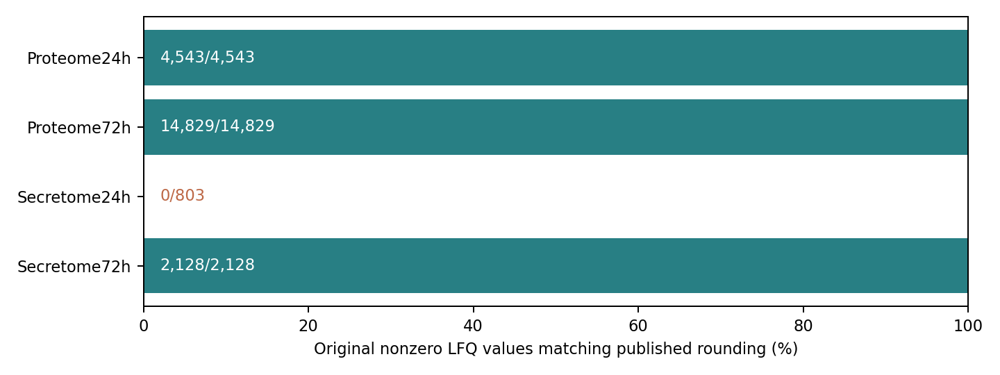
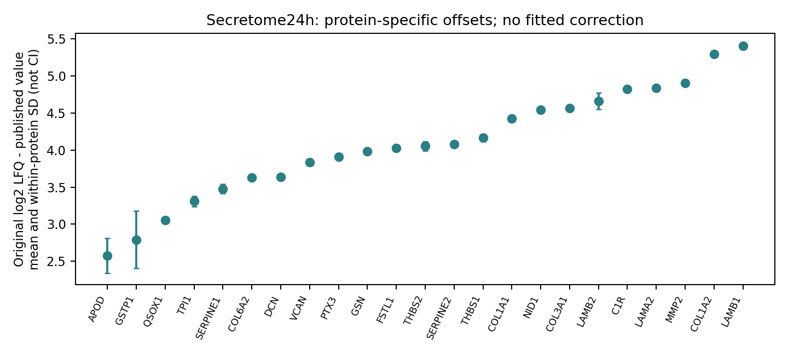

# 分泌蛋白组来源诊断与成人ASM公开材料续接

2026-10-10｜结果后来源诊断｜实际BioExplainR 0.4.0.9000｜在线模型调用0

## 1 本轮结论与固定比较范围

24h存档secretome与发表表的差异仍未得到处理原因确认；已排查同来源四数组、原样本解码、LFQ/Intensity及肽数归一化。本轮取得新的真实ASM细胞外囊泡来源与六患者映射，但没有取得可用于固定候选GC/vehicle验证的未筛定量数组。ANGPTL2/FSTL3尚未确认GC分泌响应，旧FBN2范围敏感线索保留。

四个原MaxQuant proteinGroups与原解码、Table S2按SHA256冻结；4,043/3,097胞内原组、600/531上清原组，168个实际技术/重复列。按Protein IDs精确优先、唯一Majority IDs回退，不按基因选最优组。ALL总Intensity精确比较，DIFF相同日期/条件/重复编号比较非零log2 LFQ（容差0.000051）；零保持缺测。诊断不产生新蛋白效应P值。

表1 四数组与原发表对应工作表。ALL一致包含零；非零ALL列单独排除零零。原零/发表有限不当作原实测。

|数组|ALL一致/全部|非零ALL一致|非零LFQ一致/可比|原零/发表有限|

|---|---|---|---|---|

|proteome24|3943/3943|3870|4543/4543|245|

|proteome72|3017/3017|3002|14829/14829|543|

|secretome24|9/467|0|0/803|25|

|secretome72|380/380|377|2128/2128|320|

图1 非零LFQ逐格一致比例。三个对应数组全部舍入一致，24h secretome为0/803；非参数效应/显著性未在本图评价。

## 2 24h差异能排除什么

24h secretome ALL467位置中466可唯一对应，9个总Intensity相等全部是双方为零：正Intensity一致0。其他对应数组正值ALL一致3,870/3,943、3,002/3,017、377/380。三个数组非零LFQ分别4,543/4,543、14,829/14,829、2,128/2,128一致，表明本轮解析/日期解码可以正确恢复其尺度。

24h secretome发表23个选中蛋白共828技术值，原803非零LFQ均不同；另25原零却发表有限。交叉对应secretome72/胞内24/胞内72非零LFQ分别690/467/418，精确舍入匹配均0；不能解释成简单整表来源互换。未归一Intensity非零812也0匹配；四数组均无逐样本iBAQ列，iBAQ不可对应而不是测量0。

差值原log2 LFQ−发表值2.027–5.446；每个蛋白平均偏移2.577–5.408，显示蛋白特异结构。六固定诊断公式（LFQ或Intensity分别除以总/razor+unique/unique肽数）4,968位置均未匹配。蛋白内偏移相对小或高相关不能证明同一处理结果，拟合偏移不用于修正发表数值；更复杂MaxQuant/Perseus版本差异仍未排除。

图2 23个发表选中蛋白的非零测量偏移均值与蛋白内SD；SD不是推断CI，蛋白由旧发表差异筛选，不能代表全数组。

原文明确四组分别处理、MaxQuant1.6.11/Perseus1.6.5及六供体、三个技术重复。24h来源处理差异、72h样本范围、旧proteome1.6.15冲突继续保存。本轮不能宣布作者错误或原Perseus复现成功。

## 3 新成人ASM来源与已有候选蛋白证据

表2 实际取得的重点来源。文献证据与本轮原数组重算计数分别注明。

|来源|实际材料|可用范围|

|---|---|---|

|PXD055968 / ASM EV|六患者/18run；54RAW/MSF/pdResult＋FASTA/映射；13页补充|真实ASM EV来源；未筛定量导出未取得；无GC/vehicle|

|PMC6706008 / PTX3|ASM DEX分时上清ELISA；RU486；原图注/方法|已有PTX3分泌/药理GR支持；无逐供体重算，年龄/时点冲突|

|PMC5686396 / cough|11健康/6咳嗽；FP＋polyIC；32因子Luminex|真实成人ASM上清；聚焦面板，非固定候选未筛蛋白组|

范围检索六Europe PMC查询分别63/60/30/5/1/25条，去重180文献；按公开顺序规则最多30篇请求全文，部分HTTP500，未说全部180篇均审读。PRIDE正确检索1/7/0/0条、唯一8项目，无关检索0；最初普通/projects接口忽略词返回相同100条，已明确排除其相关命中意义。八项目逐项适用性表公开；未取得合格数组不等于数组不存在。

PXD055968来源原文Celle等2025 iScience：患者原代BSM培养上清72h分离EV。原映射：非哮喘595/614/615，哮喘BA184/BA185/BA186，每标签3run共18；原表写biological replicates，同患者重复不可称18独立供体，43为全研究受试者，不是蛋白n。无GC/vehicle因子，临床所有哮喘者ICS暴露也不可改成体外GC因果比较。个体年龄与未知别名未完全核实。

54RAW/MSF/pdResult＋FASTA/文件映射共56清单项取得；未下载全部大RAW/搜索数据库，没有未筛定量文本导出。PRIDE写ProteomeDiscoverer2.5/Mascot2.5/Proline、2020数据库、5%背景推断；原文写PD3.0/CHIMERYS、2023数据库及低5%随机填补，冲突不能猜同一处理版本。真实13页出版社补充通过题名/作者/PII及PDF解析核对。

PTX3原ASM文献（2019 PLoS ONE）：肺切除来源原代ASM、DEX分时上清ELISA及RU486；属于已有PTX3蛋白/药理GR线索，不是本轮首次生物发现。缺逐供体原ELISA、年龄未列，五independent experiments不作五已核实供体；正文48h/图注24h与promoter叙述冲突保留，非NR3C1遗传因果。旧HTPC PTX3 Holm112=.592未通过不改变，不替代PER2/METTL7A/ANGPTL2/FSTL3验证。

## 4 原文/补充冲突、核验与下一步

表3 PXD055968原补充选中糖酵解表原值（13页末页），不是本轮新统计。

|蛋白|发表fold change|发表Expr P|发表Expected|

|---|---|---|---|

|ALDOA|1.109|0.258|Up|

|ENO1|1.043|0.572|Up|

|GAPDH|1.014|0.59|Up|

|PFKL|1.092|0.397|Up|

|PGAM2|1.26|0.0912|Up|

|PGK1|1.297|0.443|Up|

|PKM|1.211|0.241|Up|

|TPI1|1.25|0.132|Up|

原文称8个糖酵解蛋白significative upregulated，实际补充Expr P为.0912–.590，8/8大于.05。表中Expected Up为原IPA栏，不能把通路P或Z-score写成八蛋白显著；也不推断作者全数组无显著蛋白。以线性文本和PDF坐标双解析核对16个fold/P值。选中/通路表未见ANGPTL2/FSTL3/FBN2不表示完整数组未检出。

独立R从四原数组与原解码重建281,232逐测量比较、31,228总Intensity比较、168样本列、4,968公式与48摘要；独立Python不用openpyxl而解包Excel原XML/styling核对23,436发表测量、31,228ALL位置及EV六患者/18run。实际BioExplainR两个generic context/项目/中英文报告保存完整计数与范围，不把来源诊断包装为差异表达或P值；在线调用0。

优先后续是取得PXD055968实际Proline/PD未筛定量导出并确认版本/个体年龄/重复层级，再另冻结完整候选识别检查；即使识别成功也只回答ASM EV身份，GC响应仍需有药物配对数组。24h差异需原Perseus项目/处理版本材料。本轮没有人工作者联络、没有新湿实验；既有候选结果继续按原有效配对及全family解释。

复现与原始数据：research/results/discovery_secretome_provenance_v1/complete为最终输出，根首轮不完整比较保留；EXECUTION_NOTES逐项记录下载中断、解码/Excel日期/布尔类型、补充URL及分母修订。新provenance_manifest仅对旧secretome的根rgo依赖使用开始精确快照，其他旧科学原路径/hash；2,905保护文件核验。GitHub和外部上传继续暂停。

来源：[1] Stepanov等，Cells2022;11:3164，doi:10.3390/cells11193164，TableS2/PXD033504/033514/033534。[2] Celle等，iScience2025;28:112546，doi:10.1016/j.isci.2025.112546，PMC12141081/PXD055968。[3] Glucocorticoids regulate pentraxin-3 expression in human airway smooth muscle cells，PLoS ONE2019，doi:10.1371/journal.pone.0220772。[4] Impaired innate immune gene profiling in airway smooth muscle cells from chronic cough patients，BiosciRep2017，doi:10.1042/BSR20171090。全部原响应、方法/图表段落和获取hash保存。
