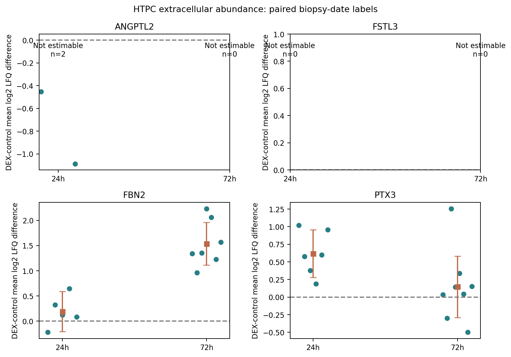
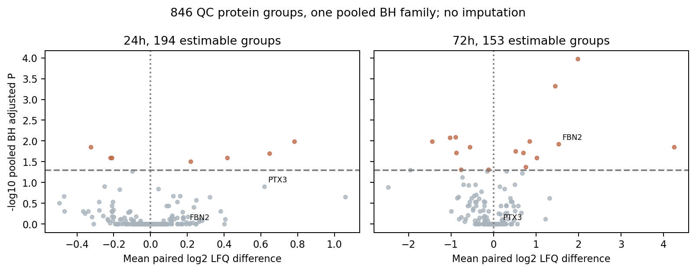

# PXD033504完整分泌蛋白组：ANGPTL2／FSTL3及固定候选的分泌层面证据

2026-10-10｜公开数据结果后探索｜固定56基因×2时点｜BioExplainR 0.4.0.9000

## 1 完成范围与独立单位

本轮已取得PXD033504两个完整未筛proteinGroups、原样本解码、参数及summary。目标成员跨全部固实块，4,170个成功HTTP206段与header段覆盖全部容器；两个容器分别核对PRIDE上游SHA1，8个成员CRC通过。完整指公开处理蛋白数组，本轮未重新搜索RAW谱图。

HTPC为人睾丸管周平滑肌样细胞，1µM DEX对溶剂对照，24/72h。供体按原日期解码，三技术重复先平均log2LFQ，每条件至少2/3可测，至少三配对日期才检验。LFQ0缺测、不填补。secretome每时点样本范围由原解码、summary与发表六标签分别核对，不能沿用旧proteome七标签结论。与旧proteome同一生物学来源，不增加独立ASM供体。

原secretome参数：24h MaxQuant 1.6.11.0；72h MaxQuant 1.6.11.0。原发表/PRIDE记录1.6.11.0；实际是否一致依原参数，旧proteome1.6.15.0版本冲突仍仅属于其原范围。

24h原LFQ与发表标签比较：范围一致。原数组标签：02.10.19、07.06.16、10.03.09、10.09.19、12.03.19、18.11.14。

72h原LFQ与发表标签比较：不一致标签为10.09.19、18.11.14，新增标签的作者QC/年龄未知，发表子集另分析。原数组标签：02.10.19、07.06.16、10.03.09、10.09.19、12.03.19、18.11.14、21.10.14、28.08.14。

表1 完整数组与固定候选分母。全数组两时点共846个QC组统一BH；候选共112项Holm，缺测P=1占位但效应/CI为空。

|时点|原组/QC组|标签/技术列|全组可估计|统一BH通过|候选可估计/56|

|---|---|---|---|---|---|

|24h|600/466|6/36|194|7|2/56|

|72h|531/380|8/48|153|16|2/56|

全部原QC、可估计/不足配对组、检测候选与未检出位置分别公开，不按新显著性替换原名单。技术列和供体日期均从原解码及summary双源核对，并与PRIDE RAW文件名逐一匹配。

## 2 候选实测结果与供体分布

表2 所有可估计候选及ANGPTL2缺测位置。效应为每供体DEX−control平均log2LFQ差，CI点态95%；Holm112仅对应本轮56×2家族。

|基因|时点/n|log₂ LFQ差|点态95%CI|Holm112 P|↑/↓|

|---|---|---|---|---|---|

|ANGPTL2|24h/2|不可估计|不可估计至不可估计|1|insufficient_pairs|

|FSTL3|24h/0|不可估计|不可估计至不可估计|1|insufficient_pairs|

|PTX3|24h/6|0.620|0.281至0.959|0.592|6/0|

|FBN2|24h/5|0.193|-0.204至0.590|1|4/1|

|ANGPTL2|72h/0|不可估计|不可估计至不可估计|1|not_detected|

|FSTL3|72h/0|不可估计|不可估计至不可估计|1|insufficient_pairs|

|PTX3|72h/8|0.147|-0.289至0.584|1|6/2|

|FBN2|72h/7|1.535|1.112至1.958|0.0127|7/0|

ANGPTL2 24h：insufficient_pairs，2个有效配对标签；效应不可估计，CI 不可估计至不可估计，Holm112=1，精确Holm112=1。

ANGPTL2 72h：not_detected，0个有效配对标签；效应不可估计，CI 不可估计至不可估计，Holm112=1，精确Holm112=1。

FSTL3 24h：insufficient_pairs，0个有效配对标签；效应不可估计，CI 不可估计至不可估计，Holm112=1，精确Holm112=1。

FSTL3 72h：insufficient_pairs，0个有效配对标签；效应不可估计，CI 不可估计至不可估计，Holm112=1，精确Holm112=1。

ANGPTL2 24h唯一组有14条肽/13条unique肽，序列覆盖37.3%；两个合格日期标签的配对差分别−.453和−1.088，与ASM转录下调方向一致，但n=2低于固定至少三供体规则，不能报告确认统计。FSTL3两时点各2条unique肽；24h仅10.09.19有co1/dex2个非零LFQ技术测量、72h该标签co0/dex2，不满足配对阈值。识别和可分泌注释不等于药物响应已确认。

ANGPTL2跨层方向：24h unavailable_or_control；72h unavailable_or_control。ASM为BUD转录、HTPC为DEX上清蛋白，药物/组织/剂量/尺度不同；同向是线索，反向是范围限制，均不能直接替代ASM分泌验证。

FSTL3跨层方向：24h unavailable_or_control；72h unavailable_or_control。ASM为BUD转录、HTPC为DEX上清蛋白，药物/组织/剂量/尺度不同；同向是线索，反向是范围限制，均不能直接替代ASM分泌验证。

图1 重点候选每个可测日期标签的药物响应及均值/点态CI；两时点不按点位置连线。缺测不是无变化。

## 3 敏感性、直接时间差与分泌注释

表3 发表六标签子集与严格3/3技术测量。每种方案各112项Holm，均不是新增队列。

|基因/时点|方案|配对n|效应|Holm112 P|状态|

|---|---|---|---|---|---|

|ANGPTL2/24h|发表六标签|2|不可估计|1|insufficient_pairs|

|ANGPTL2/24h|严格3/3技术测量|2|不可估计|1|insufficient_pairs|

|ANGPTL2/72h|发表六标签|0|不可估计|1|not_detected|

|ANGPTL2/72h|严格3/3技术测量|0|不可估计|1|not_detected|

|FSTL3/24h|发表六标签|0|不可估计|1|insufficient_pairs|

|FSTL3/24h|严格3/3技术测量|0|不可估计|1|insufficient_pairs|

|FSTL3/72h|发表六标签|0|不可估计|1|insufficient_pairs|

|FSTL3/72h|严格3/3技术测量|0|不可估计|1|insufficient_pairs|

|FBN2/24h|发表六标签|5|0.193|1|estimable|

|FBN2/24h|严格3/3技术测量|5|0.193|1|estimable|

|FBN2/72h|发表六标签|5|1.466|0.27|estimable|

|FBN2/72h|严格3/3技术测量|6|1.419|0.0259|estimable|

FBN2 72h主分析7/7可测标签↑，+1.535（CI+1.112至+1.958），Holm112=.0127；严格3/3技术测量6/6↑，+1.419（.0259）。发表六标签中只有5对可测：+1.466、Holm112=.270未通过，精确校正全部未确认。此线索对供体范围敏感，不能写为发表六成人已确认；24hFBN2不通过。PTX3 24h6/6↑但Holm112=.592，72h亦未通过且一轮留一方向反转。

ANGPTL2直接72h−24h药物响应差：n=0，insufficient_pairs，效应不可估计，Holm56=1。两个时点各自MaxQuant处理，虽secretome原文使用相同LC梯度，也不能将此差解释为绝对分泌累积、分泌速率或无混杂药物×时间机制。

FSTL3直接72h−24h药物响应差：n=0，insufficient_pairs，效应不可估计，Holm56=1。两个时点各自MaxQuant处理，虽secretome原文使用相同LC梯度，也不能将此差解释为绝对分泌累积、分泌速率或无混杂药物×时间机制。

UniProt reviewed Q9UKU9(ANGPTL2)、O95633(FSTL3)原JSON保存：两者有Secreted/信号肽注释。ANGPTL2的内皮出芽/旁分泌功能注释，FSTL3对activin等TGFβ家族结合/拮抗注释，只提供可分泌蛋白身份和已有功能背景；本轮没有测量候选受体通路、GR依赖或ASM收缩功能。FSTL3还存在核内/异构体注释，bottom-up共同肽不能确认分泌异构体。

培养上清LFQ是细胞外相对丰度，可能受分泌、释放、死亡、细胞数、摄取和降解影响；原MS每样本固定750ng上样，不是每细胞单位时间绝对通量。跨组织同向可作为线索，反向结果保留，不能将ASM RNA方向直接等同于HTPC分泌。

## 4 完整分泌蛋白组与发表处理范围

图2 完整可估计蛋白组的效应与统一BH。橙色BH<.05，灰色未通过；不足配对组仍在全family分母内但不绘为零效应。

全数组不要求single-gene，结果单位是protein group；固定基因只取唯一single-gene且QC合格组。合并基因组不分配为单基因效应。全部精确统一BH与固定Holm结果另列，小样本精确校正未确认不改写为非参数成功。

原发表24h ALL共467组，原数组exact匹配423；发表DIFF选中23组，逐格比较828技术测量，0舍入一致、25原LFQ0却发表有限值。全部差异逐格保留；不猜作者缺失值处理，不从选中表缺席推断阴性。

原发表72h ALL共380组，原数组exact匹配346；发表DIFF选中68组，逐格比较2448技术测量，2128舍入一致、320原LFQ0却发表有限值。全部差异逐格保留；不猜作者缺失值处理，不从选中表缺席推断阴性。

进一步诊断24h：按Protein IDs/原Majority IDs可对应466/467发表ALL组，总Intensity原值相同9组；选中表log2(未归一Intensity)也无逐格匹配。非零原LFQ log2−发表值范围2.03至5.45。

进一步诊断72h：按Protein IDs/原Majority IDs可对应380/380发表ALL组，总Intensity原值相同380组；选中表log2(未归一Intensity)也无逐格匹配。非零原LFQ log2−发表值范围-5.05e-05至5.09e-05。

24h原LFQ的803个非零选中测量均不匹配发表log2值，ALL总Intensity也只有9/467一致；差不是四位舍入或统一常数偏移，作者处理/输入差异尚未核实。因此本轮24h明确是存档MaxQuant数组新重分析，不能称复现原Perseus结果。72h非零2128测量匹配舍入，原LFQ0的320个发表有限值仍无法当作原非零实测；本轮不填补。

## 5 数值复核、结论与复现

独立R从原proteinGroups、解码与summary重建35,016个LFQ测量、5,836供体组行、846全组统计/统一BH及112候选Holm、224敏感性、56直接时间差、26留一方向；全部通过。Python原输出与R是同来源复核，不增加独立证据。

实际源码载入BioExplainR 0.4.0.9000，完整分泌蛋白组与固定候选两个context、项目和中英文HTML已保存；全family=846及112完整事实分母通过，在线调用0。统计由原数组及Python/R计算，BioExplainR用于事实和范围组织。

候选与原ASM转录同向且Holm112通过：FBN272h。可估计但反向：无。完整缺测和未通过条目不删除。

ANGPTL2/FSTL3有可分泌身份；具体药物响应须按表2/3的方向、有效配对、家族校正和敏感性解释。可测不等于支持ASM方向。培养上清或跨组织RNA-蛋白方向不能建立ASM分泌/GR/功能因果。

完整56×2、全部QC蛋白组、原测量、日期效应、敏感性/时间差、发表逐格冲突和UniProt注释见tables及research/results/discovery_secretome_v1。保存结果核验/新目录数值复现见README。实际下载重试和修订见EXECUTION_NOTES。

来源：[1] Stepanov YK et al. Cells 2022;11:3164，doi:10.3390/cells11193164，PMC9562650，TableS2。[2] PRIDE PXD033504，两SEARCH完整处理容器；来源文件清单/项目API原响应已保存。[3] UniProt Q9UKU9、O95633原公开JSON，本轮查询UTC及hash保存。[4] ASM原54集合及六成人来源的独立封存v0.12结果（本轮不重算RNA）。
